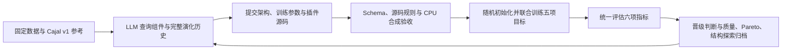

# nanoBrain · 虚拟细胞架构演化

nanoBrain 用 LLM 持续提出虚拟细胞模型的架构、目标函数和训练策略，再由程序执行候选验收、训练、统一评估与晋级。每次提案的假设、源码、父系和实验结果都会进入研究记录，形成“提案、训练、复验、晋级”的演化闭环。

本分支在 **Cajal v1 共享模型**上实现 ReAct 自动研究。每个候选从随机初始化开始，以一份模型联合学习五项任务，并用同一个 checkpoint 接受全部评估。

[项目网站](https://novaeve.github.io/nanobrain/) · [演化协议](variants/cajal-react/README_CAJAL_REACT.md) · [部署说明](variants/cajal-react/README.md) · [数据发布](https://github.com/novaeve/nanobrain/releases/tag/cajal-react-data-20261106)

## 研究目标

演化目标是在细胞类型、脑区、批次整合、基因插补和空间插补上共同改善模型。候选之间使用固定数据、训练预算和评估定义比较，六项指标共同决定 joint frontier。

| 项目 | 当前配置 |
|---|---|
| 预训练数据 | 1,015,388 个健康人脑细胞，全量参与联合训练 |
| 输入 | 65,918 基因词表、原始 counts、逐细胞测量面板与空间邻居 |
| 模型 | 一份共享模型，五个联合目标，同一 checkpoint 评估 |
| 搜索 | ReAct 工具调用、组件组合、受限源码扩展与训练参数演化 |
| 演化预算 | 30 代 × 10 候选，每候选 seed=0、10,000 步 |

## 演化闭环



### 提案与搜索空间

LLM 可以查询完整演化 DAG、各候选的成败记录、组件来源与既有 Cajal 基线，声明研究假设，再通过工具提交完整候选。父代传递架构、源码和超参数。每个候选都相对冻结的 Cajal v1 配方完整描述自身配置。

| 搜索方向 | 可演化内容 |
|---|---|
| 模型结构 | 数值嵌入、token 处理、attention / mixer、latent、分类头、表达解码器与邻域模型 |
| 联合目标 | 五任务损失权重、梯度均衡、FAMO、KL 与已开放的正则化目标 |
| 优化策略 | 优化器、学习率、weight decay、warmup、梯度裁剪与学习率日程 |
| 训练采样 | 表达细胞数、空间组数、非零 token 上限与测量零值采样数量 |
| 源码扩展 | 在接口和源码规则内提交 PyTorch 模块、损失函数与优化器 |

初始架构包含基因 token 编码、循环 MoE、N-BEATS 残差、层级分类头、NB 解码器和邻域模型。组件目录登记 111 项，源快照记录了 52 个结构组件、67 个适用插槽接口的合成核验。候选模型上限为 200M 参数，源码每文件上限 32 KiB、合计上限 128 KiB。具体字段和约束由候选 schema 与 contracts 定义。[组件目录](variants/cajal-react/component_library/catalog.json) · [候选 schema](variants/cajal-react/schemas/cajal-candidate.schema.json) · [契约实现](variants/cajal-react/cajal_research/contracts.py)

### 验收、训练与复验

候选先通过 schema、参数和源码规则检查，再进入 Linux bwrap CPU 沙箱，使用合成数据检查五任务的张量接口、梯度、参数更新与权重重载。验收通过后，从随机初始化开始进行真实联合训练。同一候选、seed、协议和训练配置可以恢复自身断点，训练身份与产物哈希会逐项核对。

### 晋级与后续探索

六项指标完整且有限的候选进入比较。晋级要求目标指标相对父代和固定参考均提升超过 0.005，任一指标相对父代的退化不超过 0.005，同时改善 joint-frontier 排序。排序优先比较相对基线最弱的一项，再比较平均相对增益。

后续父代从质量、Pareto 和结构探索档案中选取。完整谱系保留失败与未入选分支，下一轮提案可以继续读取这些证据。晋级规则的实现见选择模块。[选择与晋级实现](variants/cajal-react/cajal_research/selection.py)

## 五项任务与六个报告指标

| 任务 | 研究问题 | 报告指标 |
|---|---|---|
| 细胞类型注释 | 从表达预测细粒度细胞类型 | Fine macro-F1 ↑ |
| 脑区注释 | 从表达预测细粒度解剖脑区 | Fine macro-F1 ↑ |
| 批次整合 | 保留生物信号并降低批次影响 | Integration bio ↑、Integration batch ↑ |
| 基因插补 | 重建遮蔽的测量基因表达 | 每细胞 Pearson 相关的中位数 ↑ |
| 空间插补 | 利用可见邻居重建被遮蔽表达 | 每细胞 Pearson 相关的中位数 ↑ |

研究评估集与预训练细胞不重叠，评估结果会反复用于演化反馈，成绩属于探索性研究结果。当前使用单 seed，记录 `seed_count=1`、标准差为 null。已有 Cajal 参考模型与 13 个整方法基线采用冻结记录，候选用同一评估口径评分。[评估协议](variants/cajal-react/reference/evaluation_protocol.json) · [参考基线](variants/cajal-react/reference/opponents.json)

## 固定实验协议

| 项目 | 设置 |
|---|---|
| 协议 ID | `CAJAL-V1-JOINT-REACT-SELF-CONTAINED-20261110` |
| 初始配方与参考 | `cajal_v1` 架构，已有 `cajal_v1@10000` 参考记录 |
| 提案模型 | `gpt-6.1-sol`，`reasoning_effort=max` |
| 候选训练 | 随机初始化，`random_init_self_contained` |
| 总预算 | 30 代，每代 10 候选，最多 300 次新联合训练 |
| 训练与评估 seed | 固定为 0 |
| 学习率日程与停止点 | 30,000 步日程，固定在 10,000 步停止并评估结束 checkpoint |
| 调度配置 | GPU 0–7，全局最多 16 个并行阶段，每卡最多 3 个 worker |
| 验收与任务评估并发 | 最多 4 个 CPU 合成验收，每候选最多 2 条任务评估流水线 |

实际并发还受候选数量、显存和主存约束。训练阶段初始预留 32 GiB 显存，评估阶段预留 8 GiB，每卡另留 4 GiB 余量。资源不足时排队，OOM 重试会提高预留。同代父代池冻结，晋级按候选序号应用，控制器交接接管已运行的阶段。配置与完整协议均随源码保存。[演化配置](variants/cajal-react/configs/cajal_react.json) · [完整协议](variants/cajal-react/README_CAJAL_REACT.md)

## 数据与下载

预训练数据与三个研究评估集通过 GitHub Releases 发布，标签为 `cajal-react-data-20261106`。分卷、合并归档、原始 manifest 和数据文件均有 SHA-256 校验记录。

| 数据目录 | 细胞数 | 作用 |
|---|---:|---|
| `unified_1m` | 1,015,388 | 全量参与联合预训练 |
| `eval_10k` | 9,960 | 细胞类型、脑区、基因插补 |
| `eval_integration_10k` | 9,867 | 批次整合 |
| `eval_spatial` | 40,789 | 空间插补 |

```bash
git clone --branch research/cajal-react-joint-20261106 https://github.com/novaeve/nanobrain.git
cd nanobrain
python variants/cajal-react/scripts/download_data.py
```

下载器要求 Python 3.12+，默认解压到 `assets/cajal/`，校验每个分卷、合并归档、原始 manifest、行数和全部数据文件。完整解压体积约 16 GB，下载、合并和解压过程建议预留 35 GB 空间。已有分卷会通过校验后复用。

```bash
python variants/cajal-react/scripts/download_data.py --verify-only
```

原始 counts、测量面板、标签层级、空间邻居和来源行身份按发布定义保存。来源、抽样和空间组定义见数据说明。[数据说明](variants/cajal-react/data_build/UNIFIED_1M.md) · [发布清单](variants/cajal-react/reference/data-release.json)

## 查看计划与启动演化

Cajal 运行环境为 Linux、Python 3.11+、PyTorch 2.9+，GPU 训练沿用对应 CUDA 与 FlashAttention-3 等扩展环境。完整演化需要独立 Git 根目录、通过指纹检查的数据、既有 Cajal 参考工件、整合评估缓存、组件依赖和 API 环境配置。部署说明包含独立源码导出及资源准备步骤。[部署说明](variants/cajal-react/README.md)

```bash
# 在准备好的独立 Cajal Git 根目录和 Linux 训练环境中执行
python -B scripts/cajal_react.py

# 显式启动或恢复演化
python -B scripts/cajal_react.py --execute
```

默认入口打印计划，`--execute` 进入真实 LLM 提案与训练流程。配置中的 `status` 字段保留源码模板值，实际进度由结果目录的 `status.json` 记录。

## 实验记录与产物

默认结果目录为 `research-runs/cajal-react-self-contained-20261110/`，相对于部署后的独立 Cajal Git 根目录。

| 产物 | 内容 |
|---|---|
| `status.json` | 当前阶段、代数、活动任务和调度状态 |
| `run-contract.json` | 代码、配置、输入与参考工件的冻结指纹 |
| `lineage/` | 完整演化谱系、候选源码、配置、验收与结果 |
| `jobs/` | 联合训练、预测和评分阶段的 checkpoint、回执与产物 |
| `decisions/` | 逐候选晋级判断及依据 |
| `standard_metrics.csv` | 演化完成后导出的逐候选、逐 seed 标准指标与采样参数 |
| `frozen-champion.json` | 演化完成后导出的冠军 bundle、解析配置、结果和外部权重依赖清单 |

训练失败、资源不足和指标缺失分别记录。最终结果同时保存 `improvement_found`，用于说明此次搜索是否找到通过晋级门槛的候选。

## 演化代码导航

```text
variants/cajal-react/
  brainwm_unified/    Cajal 共享模型、数据加载、联合目标与训练
  cajal_research/     ReAct 工具、验收、调度、谱系、选择与恢复
  component_library/ 可组合组件、上游来源、许可与依赖记录
  configs/           初始配方、演化预算与实验配置
  schemas/           候选源码和参数的提交契约
  reference/         固定评估协议、参考成绩、数据发布与来源记录
  scripts/           数据下载、训练、预测、评分和演化入口
  tests/             演化边界、独立训练、并发与恢复检查
assets/cajal/        下载后的预训练数据和研究评估集
```

## 源码与复现

本分支为 `research/cajal-react-joint-20261106`，Cajal 源码同步自服务器提交 `3891dc162cd9be5aa25876b948e02372ac86318e`。发布目录保留源码来源与逐文件核对记录。[源码快照记录](variants/cajal-react/reference/source_snapshot.json)

复现实验时记录代码提交、配置、数据指纹、硬件、随机种子、实际训练预算和六项指标。新增组件保留上游来源、许可和接口验收记录，研究结果连同失败分支一起归档。
