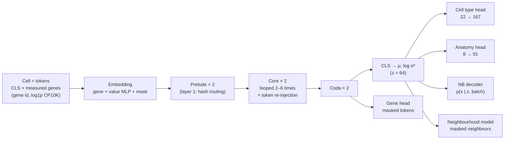

> **Cajal ReAct preparation — not started.** This independent checkout starts from the existing Cajal v1 architecture and jointly trains all five objectives. See [README_CAJAL_REACT.md](README_CAJAL_REACT.md) for the evolution protocol and preparation checks. The remaining document describes the original Cajal project.

# Cajal

<p align="center">
  <strong>One encoder for the brain's cells: annotation, region, integration, imputation and space, learned together.</strong>
</p>

<p align="center">
  <a href="#results">Results</a> ·
  <a href="#architecture">Architecture</a> ·
  <a href="#infrastructure">Infrastructure</a> ·
  <a href="#data">Data</a> ·
  <a href="#quick-start">Quick start</a> ·
  <a href="#evaluation">Evaluation</a> ·
  <a href="#repository-layout">Layout</a>
</p>

**Language:** English · [简体中文](README_zh-CN.md)


-76B900?logo=nvidia&logoColor=white)


Cajal is the current version of **Brain World Model (BrainWM)**, the internal codename of the unified
redesign. A single Transformer encoder reads each cell as a set of `(gene, expression)` tokens and is
pretrained jointly on five objectives over the same **Cell × Gene table**:

| Objective | What is masked or predicted | Downstream ability |
|---|---|---|
| Gene imputation | 15% of a cell's measured genes | Denoising, imputation |
| Integration | Batch-conditioned negative-binomial decoder (scVI-style) + KL | Batch-corrected latent |
| Cell type | Hierarchical head, lineage (22) → cell type (167) | Annotation |
| Anatomy | Hierarchical head, division → region (8) → structure (91) | Region annotation |
| Spatial | 30% of a MERFISH cell's neighbours, from the rest of the niche | Spatial imputation |

Cajal v0 divides every task loss by its mean over the first 200 steps; Cajal v1 instead gives every loss the
same gradient norm on the encoder (`grad_equal`, [`balance.py`](brainwm_unified/balance.py)). Downstream tasks (development, ageing, perturbation, disease) come later as post-training.

> [!NOTE]
> Cajal is research code under active development on one 8×H20 server. Paths in `scripts/` and the
> data defaults point at that server (`/data/brainwm/...`); see [Data](#data) for what each directory holds.

## Results

Zero-shot on held-out cells that never appear in pretraining (four evaluation sets, one per kind of task;
see [Data](#data)). Nothing is fine-tuned on them. Every baseline is trained on the same pretraining
subset (unified_1m) with the same 2,000 highly variable genes; scVI and scANVI run on the GPU with
scvi-tools' settings for atlas integration.

| Method | Cell type F1 | Region F1 | Integration bio | Integration batch | Gene imputation r | Spatial imputation r |
|---|---:|---:|---:|---:|---:|---:|
| **Cajal v0** (30k steps) | **0.811** | **0.767** | 0.611 | 0.263 | **0.789** | 0.271 |
| scANVI (cell type / region labels) | 0.703 | 0.497 | 0.625 | 0.454 | – | – |
| scVI | – | – | 0.609 | 0.449 | – | – |
| scVI fitted on the evaluation set itself | – | – | 0.623 | **0.504** | – | – |
| XGBoost (GPU) | 0.743 | 0.682 | – | – | – | – |
| Logistic regression (cuML) | 0.740 | 0.634 | – | – | – | – |
| Unintegrated PCA | – | – | 0.581 | 0.267 | – | – |
| Same-panel kNN / gene mean | – | – | – | – | 0.700 / 0.531 | – |
| Neighbour mean (log / CP10K space) | – | – | – | – | – | **0.368** / 0.276 |

F1 is fine-level macro-F1; integration is scored with [scib-metrics](https://github.com/YosefLab/scib-metrics)
(batch = integration batch, label = cell type); imputation r is the median per-cell Pearson correlation on
log1p CP10K. Every metric, both levels and the training trajectories are in `runs/eval/<task>/table_latest/`
and `runs/eval/five_tasks.csv`.

- **Ahead:** cell-type and region annotation (above XGBoost, logistic regression and scANVI) and gene
  imputation (above kNN).
- **Behind:** batch correction, where scVI and scANVI remove more batch signal (0.45 vs 0.26), and spatial
  imputation, where averaging the neighbours in log space is still better.
- **Why integration lagged:** with every task loss divided by its initial value, integration received 2–3% of
  the encoder's gradient. Giving every loss the same gradient norm (`grad_equal`) raised batch correction from
  0.228 to 0.358 at 10k steps with every other task unchanged, and is the setting of **Cajal v1** (30k steps,
  in training). The experiments behind this, kept and dropped, are listed with their outcomes by
  `cajal catalog experiments`.

## Architecture



Each block is attention over the cell's own tokens followed by a DeepSeek-style mixture of experts,
with an N-BEATS backcast/forecast residual.

| Component | Setting |
|---|---|
| Width / heads | d = 256, 4 heads × 64 |
| Attention | FlashAttention-3 varlen, one sequence per cell (no padding, no cross-cell attention) |
| MoE | 32 routed experts (top-4) + 1 shared, SwiGLU hidden 256; sqrt-softplus router (V4); aux-loss-free bias balancing (V3); first layer routes by gene id (V4 hash routing) |
| Depth | 2 prelude + 2 core looped 2–6× (4 at evaluation) + 2 coda = 12 block calls |
| Latent | z = 64, μ used at evaluation |
| Optimiser | Muon on hidden matrices (batched Newton–Schulz), AdamW elsewhere; lr 1e-3, cosine, 1k warm-up |
| Step | 128 dissociated cells + 16 spatial groups (centre + 16 neighbours), ~310k tokens |

## Infrastructure

Measured on one H20 with the same real batches. Every change is checked against the previous implementation
by a GPU test before it is kept.

| Change | Effect |
|---|---|
| FlashAttention-3 varlen, 4 × 64 heads | attention kernel 2.3× faster than FlexAttention 8 × 32 |
| Grouped Muon (same-shape matrices in one batched Newton–Schulz) | optimiser 254 → ~10 ms/step |
| Stacked 3-D experts, fused gate/up GEMM, gather-only dispatch and combine | no atomics; −2.8 GB |
| Per-block `torch.compile` (all ~20 variants compiled) | 1.88 → 1.11 s/step |
| Recompute only the looped blocks' MoE branch | 0.97 → 0.88 s/step |
| Sync-free expert counts | GPU busy 91% → 96% |
| **Total (real training loop)** | **2.90 → 0.85 s/step, 138 → ~470 cells/s; MFU ~16% → ~50%** |

Inference follows LLM prefill practice (`brainwm_unified/infer.py`): unmasked deterministic batches cut to a
token budget, DataLoader prefetch, `inference_mode`, and only the modules the outputs need. 10k evaluation cells
take ~18 s; the GPU is busy 98% of the time and attention runs at ~87% of peak. FP8 attention was tried
(4% faster, 1.7% of predictions changed) and not adopted.

Profiling tools: `scripts/bench/profile_step.py` (per-phase timing and Chrome trace), `scripts/bench/flops.py`
(analytic FLOPs and MFU on real batches), `scripts/bench/trace_gaps.py` (GPU idle gaps and their CPU cause),
`scripts/bench/bench_attention.py`, `scripts/bench/bench_moe.py`, `scripts/bench/bench_infer.py`.

## Data

| Set | Cells | What it is |
|---|---:|---|
| `unified_1m` | 1,015,388 | Pretraining. Healthy human brain from the V4 train + validation shards: 314,566 spatial (MERFISH, whole 500 µm tiles) + 700,822 expression-only, capped per cell type × anatomy and per dataset. Raw counts over 65,918 genes; per-cell measurement panels separate "not measured" from "measured zero". |
| `eval_10k` | 9,960 | Annotation and gene imputation. V4 train/validation cells **not** in unified_1m whose labels unified_1m contains; IPF-balanced over anatomy and cell type, datasets spread within each stratum and capped at 5%. |
| `eval_integration_10k` | 9,867 | Integration. 55 cell types each held by at least 3 batches, equal quotas per (cell type, batch) pair, so batch and biology are not confounded (49 batches). |
| `eval_spatial` | 40,789 | Spatial imputation. 46 whole 500 µm MERFISH tiles (24 sections, the 2 verified spatial datasets) holding no pretraining or other evaluation cell; every cell has 16 neighbours. |

The evaluation sets are disjoint from unified_1m and from each other; the sealed V4 test split is never read.
All are built by the scripts in [`data_build/`](data_build/) (details in [`data_build/UNIFIED_1M.md`](data_build/UNIFIED_1M.md)).

## Quick start

Linux x86_64, CUDA 12.8, Hopper GPU, [uv](https://docs.astral.sh/uv/).

```bash
uv venv -p 3.11 && uv pip install -e . --torch-backend cu128
bash scripts/build_fa3.sh          # FlashAttention-3 (Hopper) into the venv, ~3 min; needs gcc >= 11 (toolchain/)
source env.sh

# every experiment is a TOML under configs/experiments/; the catalog shows each one's status and outcome
cajal catalog experiments
cajal run configs/experiments/cajal_v1.toml --gpus 0          # joint pretraining, 30k steps (~7.5 h on an H20)

# single-task control: only TASK has a non-zero loss weight
cajal run configs/experiments/single_task.toml --gpus 0,1

# all tests on one GPU (lint + 53 tests, ~1 min)
bash scripts/gate.sh 0
```

## Evaluation

Five tasks, four held-out sets, one folder per task under `runs/eval/` (predictions, a score folder per
checkpoint, `table_latest/summary.csv` and `trajectory.csv`):

| Task | Set | Model output | Baselines |
|---|---|---|---|
| Cell type, region | eval_10k | label heads, fine and coarse | logistic regression (cuML), XGBoost (GPU) on 2,000 HVGs |
| Integration | eval_integration_10k | latent μ, scib-metrics bio / batch | unintegrated PCA; scVI, scANVI (scvi-tools, GPU) on the same HVGs |
| Gene imputation | eval_10k | the training 15% gene mask (fixed seed), filled by the gene head | gene mean, same-panel kNN |
| Spatial imputation | eval_spatial | each cell hidden, rebuilt from its 16 neighbours | neighbour mean (log and CP10K space) |

```bash
# the checkpoints of a run, scored as they appear (one watcher per task; training env + eval env)
for t in annotation:eval_10k integration:eval_integration_10k; do
  EVAL_MODE=each EVAL_TAG=${t%%:*}/ EVAL_DATA=/data/brainwm/${t#*:} scripts/eval_watch.sh 0 30000 cajal_v1=cajal_v1 &
done
EVAL_TASK=genes   EVAL_TAG=genes/   EVAL_DATA=/data/brainwm/eval_10k     scripts/eval_watch.sh 0 30000 cajal_v1=cajal_v1 &
EVAL_TASK=spatial EVAL_TAG=spatial/ EVAL_DATA=/data/brainwm/eval_spatial scripts/eval_watch.sh 0 30000 cajal_v1=cajal_v1 &

# baselines, once: LogReg / XGBoost features and fits (eval env), scVI / scANVI (scvi env)
source scripts/eval_env.sh && python scripts/eval_zero_shot.py --prepare
for m in lr/cell_type lr/anatomy xgb/cell_type xgb/anatomy; do python scripts/eval_zero_shot.py --fit $m & done; wait
python scripts/fit_scvi.py --eval /data/brainwm/eval_integration_10k /data/brainwm/eval_10k --out runs/eval/scvi

# one table across the tasks
python scripts/merge_tables.py --out runs/eval/five_tasks.csv \
  "runs/eval/annotation/table_latest/summary.csv:Cell type fine macro-F1,Region fine macro-F1" \
  "runs/eval/integration/table_latest/summary.csv:Integration bio,Integration batch" \
  "runs/eval/genes/table_latest/summary.csv:Gene imputation Pearson (cell median)" \
  "runs/eval/spatial/table_latest/summary.csv:Spatial imputation Pearson (cell median)"
```

## Repository layout

```
brainwm_unified/
  model.py           encoder, MoE, heads, decoder, neighbourhood model, attention backends
  objectives.py      the five losses
  balance.py         loss balancing (initial / grad_equal / famo) and budgeted dual weights
  regularizers.py    extra integration objectives (registry)
  masking.py         mask-as-task: row and group mask specs, mixtures, plans (configs/masks/)
  data.py            Cell × Gene batches: tokens, masks, panels, spatial groups
  train.py           joint pretraining loop, gradient probes
  infer.py           forward-only inference: embeddings, gene and spatial imputation
  impute_metrics.py  imputation metrics shared by the model and the baselines (NumPy)
  experiment.py      TOML experiments: extends, overrides, sweeps, status / outcome
  cli.py             cajal catalog | show | run | predict | eval
configs/             base, data, model, mask plans, experiments (each with its status and outcome)
scripts/             evaluation and launch pipeline; scripts/bench/ profiling and micro-benchmarks
data_build/          scripts that built unified_1m and the evaluation sets
tests/               CPU and GPU tests: every kernel, infrastructure change and metric
```

## Acknowledgements

Cajal builds on open infrastructure: [FlashAttention-3](https://github.com/Dao-AILab/flash-attention),
[DeepGEMM](https://github.com/deepseek-ai/DeepGEMM), [DeepEP](https://github.com/deepseek-ai/DeepEP),
[torchtitan](https://github.com/pytorch/torchtitan) patterns for regional compilation,
[Muon](https://github.com/KellerJordan/Muon), [scib-metrics](https://github.com/YosefLab/scib-metrics),
[RAPIDS cuML](https://github.com/rapidsai/cuml) and [XGBoost](https://github.com/dmlc/xgboost).
Ideas come from scVI (integration), scBrain (hierarchical heads), DeepSeek-V3/V4 (MoE routing) and
N-BEATS (residual stacks). See [THIRD_PARTY.txt](THIRD_PARTY.txt).

Named after Santiago Ramón y Cajal, who first drew the brain as a world of individual cells.
