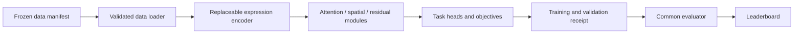
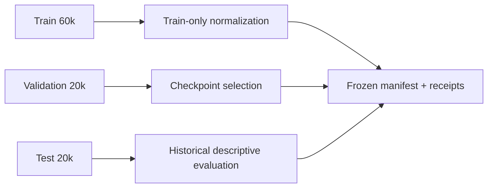

# nanoBrain

<p align="center">
  <strong>A readable, modifiable, reproducible entry point for virtual-cell experiments</strong>
</p>

<p align="center">
  <a href="#quick-start">Quick Start</a> ·
  <a href="#four-benchmark-tasks">Tasks</a> ·
  <a href="#data-and-scale">Data</a> ·
  <a href="#leaderboard">Leaderboard</a> ·
  <a href="#custom-models">Custom Models</a> ·
  <a href="#contributing">Contributing</a>
</p>

**Language:** English · [简体中文](README_zh-CN.md)


nanoBrain is a compact virtual-cell research, teaching, and prototyping project. Inspired by the readability of nanoGPT and the iteration loop of automated research frameworks, it keeps data loading, model definition, training, validation, and comparison in one understandable experiment path.

nanoBrain is a fast experimentation entry point for Brain World Model, not a smaller deployment of Brain World Model. New architectures, objectives, sampling strategies, and tasks can be tested on a manageable dataset before the useful ideas move to larger cell datasets and model campaigns.

> [!IMPORTANT]
> This repository contains a frozen and verified 100,000-cell (100k) metadata-v2 dataset: 60,000 train / 20,000 validation / 20,000 test.

> [!WARNING]
> The fixed test labels and historical results have already been opened. Use train/validation for new model selection; test leaderboard scores are descriptive historical results, not a new blind holdout.

## Quick Start

### 1. Set up the environment

The supported quick-start environment is Linux x86_64, Python 3.12, and [uv](https://docs.astral.sh/uv/):

```bash
git clone https://github.com/novaeve/nanobrain.git
cd nanobrain

# Download the dataset (100k cells, ~70MB)
wget https://github.com/novaeve/nanobrain/releases/download/v1.0.0-data/nanobrain-v3-100k-metadata-v2.zip
unzip nanobrain-v3-100k-metadata-v2.zip -d assets/

# Install CPU PyTorch, development tools, and prepare the dataset
cp .env.example .env
bash scripts/bootstrap.sh
```

For a step-by-step setup:

```
uv sync --extra cpu --extra dev
uv run nanobrain-data prepare
```

### 2. Run a minimal experiment

```
uv run python scripts/train_nanobrain.py \
  --data assets/nanobrain_v3_100k_metadata_v2 \
  --task annotation \
  --steps 20 \
  --batch-size 16 \
  --device cpu \
  --precision fp32 \
  --output results/annotation-smoke
```

Twenty steps verify data loading, model construction, backpropagation, validation, and receipt writing. They are a smoke test, not a benchmark-quality budget. The output directory contains checkpoints and a JSON receipt.

### 3. Choose a task

Set --task to one of:

```text
integration
annotation
development
spatial_niche
```

The development tutorial exposes additional sampling and validation controls:

```
uv run python scripts/train_nanobrain.py \
  --data assets/nanobrain_v3_100k_metadata_v2 \
  --task development \
  --steps 20 \
  --batch-size 16 \
  --development-cells 64 \
  --validation-development-groups 8 \
  --device cpu \
  --precision fp32 \
  --output results/development-smoke
```

### 4. Run checks and rebuild the leaderboard

```
uv run pytest
uv run python scripts/build_leaderboard.py
```

CI runs the same tests, lint checks, and leaderboard generation steps in [.github/workflows/ci.yml](.github/workflows/ci.yml).

## Experiment flow



Single-task diagnostics can use an independent model and optimizer. Evolution candidates default to `--task joint`: one model and optimizer jointly optimize annotation, integration, development, and spatial niche, and promotion uses all four primary metrics. Normal training opens train and validation only. Every run records the task, manifest, seed, step budget, validation results, checkpoint, and stability checks so experiments can be reproduced and compared on internal servers.

## Four benchmark tasks

| Task | Question | Primary metrics | Guide |
|---|---|---|---|
| **Integration** | Preserve biological expression signal while reducing batch signal | Integration composite, biology conservation, batch removal | [Guide](docs/tasks/integration.md) |
| **Annotation** | Predict cell-type labels observed in training | Macro F1, accuracy | [Guide](docs/tasks/annotation.md) |
| **Development** | Predict a target population from a source population and condition | Population MSE, gene Spearman, MMD | [Guide](docs/tasks/development.md) |
| **Spatial niche** | Predict anatomy-derived niche labels using expression and verified spatial context | ARI, NMI, spatial metrics | [Guide](docs/tasks/spatial-niche.md) |

The tasks share the data contract, component registry, trainer, and evaluator, while using independent objectives, heads, and optimizers.

## Data and scale

### Reproducible benchmark release

| Property | Current release |
|---|---|
| Dataset | nanobrain_v3_100k_metadata_v2 |
| Total cells | 100,000 |
| Split | 60,000 train / 20,000 validation / 20,000 test |
| Split ID | BRAINWM-HUMAN-GLOBAL-6-2-2-V3 |
| Expression panel | 256 genes |
| Normalization | Fit on train only |
| Metadata | metadata-v2 with repaired row identity |
| Spatial neighbors | Independently verified sections only |

Dataset preparation checks the split ID, exact row counts, metadata version, train-only normalization provenance, and every file hash declared in the manifest. It does not randomly resplit rows and does not open H5AD files in the training loop.



See the [dataset contract](docs/data.md) and [data folder notes](assets/README.md).

### Data scale overview

| Tier | Intended use | Status |
|---|---|---|
| Teaching | Courses, tutorials, and CPU smoke runs | Available through the quick start |
| Benchmark | Frozen 100k (100,000 cells) data and four tasks | Current release |

## Leaderboard

The current leaderboard is generated from a frozen unified evaluation table:

- [Leaderboard](benchmarks/nanobrain_v3_100k/LEADERBOARD.md)
- [Machine-readable metrics](benchmarks/nanobrain_v3_100k/overall_metrics.csv)
- [Benchmark status and protocol](docs/benchmark_status.md)

The nanoBrain reference uses three seeds and 2,000 optimizer steps per seed:

| Task | Metric | Mean | SD | Direction |
|---|---|---:|---:|---|
| Annotation | Accuracy | 0.2644 | 0.0101 | Higher is better |
| Annotation | Macro F1 | 0.0136 | 0.0012 | Higher is better |
| Integration | Integration composite | 0.3764 | 0.0152 | Higher is better |
| Spatial niche | ARI | 0.0601 | 0.0282 | Higher is better |
| Spatial niche | NMI | 0.1027 | 0.0138 | Higher is better |
| Development | Population MSE | 0.2315 | 0.0076 | Lower is better |
| Development | Gene Spearman | 0.5859 | 0.0340 | Higher is better |

Training budgets, data coverage, and evaluation counts can differ across methods. Inspect each method protocol before drawing comparisons.

Regenerate the summary with:

```
uv run python scripts/build_leaderboard.py \
  --input benchmarks/nanobrain_v3_100k/frozen_test_metrics.csv
```

## Custom models

nanoBrain uses a component registry so researchers can replace model parts without rewriting the data loader or trainer. The default path includes:

- MLP expression encoder
- Differential linear attention
- Bounded neighbor-mean spatial fusion
- N-BEATS-style residual correction
- Sinkhorn population matching
- Flow Matching Transformer
- Classification, regression, and completion heads

An encoder receives [batch, genes] and returns [batch, hidden] or [batch, tokens, hidden]. Start with [examples/custom_encoder.py](examples/custom_encoder.py):

```
uv run python scripts/train_nanobrain.py \
  --data assets/nanobrain_v3_100k_metadata_v2 \
  --plugin examples.custom_encoder \
  --genome-json examples/custom_genome.json \
  --task annotation \
  --steps 20 \
  --batch-size 16 \
  --device cpu \
  --precision fp32 \
  --output results/custom-annotation
```

See the [custom model tutorial](docs/custom-model.md). Receipts record plugin module names and source hashes.

## Baselines inside evolution

Baselines can now be recorded as generation-specific references during model evolution. Pass a generation number and a campaign ledger to the baseline CLI; it selects the strongest non-nanoBrain method for each primary metric on validation and appends a resumable JSON snapshot. Candidate promotion can then apply the same baseline regression gate.

```bash
uv run python scripts/run_nanobrain_baselines.py \
  --data assets/nanobrain_v3_100k_metadata_v2 \
  --generation 0 \
  --campaign-ledger results/nanobrain/evolution/campaign.json \
  --output results/nanobrain/evolution/generation-00-baselines
```

Use `nanobrain.load_generation_baseline` to read a generation snapshot and `nanobrain.baseline_regression_gate` to check a candidate against it. The ledger follows the train/validation protocol; the test split remains outside search and selection. The interface is independent of the LLM or search driver so it can be reused by longer, multi-GPU Brain World Model campaigns.

## Servers and GPUs

The quick start targets Linux CPU and works well for small servers, workstations, and cloud instances. For GPU training, install a PyTorch wheel matching the server CUDA runtime using the [PyTorch selector](https://pytorch.org/get-started/locally/), then use:

```
--device cuda
```

nanoBrain currently provides experiment CLIs, receipts, and common evaluation. It does not present the experiment CLI as a production inference service.

## Reproducibility and fair comparison

Record at least:

- data manifest and split ID
- task, seed, step budget, and batch size
- validation split and evaluation settings
- model genome and plugin source hash
- checkpoint policy and stability thresholds

Iterate on train/validation before moving a design to a larger campaign. Do not tune against the already opened test leaderboard.

## Repository layout

```text
src/nanobrain/       nanoBrain models, data contracts, objectives, and training
src/brainwm*/        Shared model, data, and benchmark components
scripts/              Environment, data, training, evaluation, and leaderboard commands
docs/tasks/           Task-by-task tutorials
benchmarks/           Frozen 100k leaderboard and source metrics
configs/              Public model configurations
examples/             Custom encoder and genome examples
tests/                Contract, data, training, evaluation, and leaderboard tests
assets/               Dataset notes; the actual bundle is not tracked
```

## Who this is for

| User | What nanoBrain enables |
|---|---|
| Research scientists | Compare architectures, objectives, samplers, and task heads quickly |
| Bioinformatics practitioners and students | Learn cell representations, training, and evaluation from readable code |
| Database and agent builders | Add local cell representation, annotation, and retrieval capabilities |
| Internal platform teams | Run bounded experiments, preserve receipts, and aggregate leaderboard results |

## Roadmap

- [x] Frozen 100k metadata-v2 data contract
- [x] Integration, annotation, development, and spatial niche tasks
- [x] CPU quick start, receipts, and common leaderboard
- [x] Replaceable component registry and custom encoder example
- [ ] More complete GPU, cloud, and server templates
- [ ] Automated experiment search, budget control, and result retention
- [ ] Local inference interfaces for bioinformatics databases and research agents

## Contributing

This is an internal open-source research foundation. A useful contribution loop is:

1. Reproduce the current baseline on the frozen 100k data and four tasks.
2. Add focused tests for new components, tasks, or data transforms.
3. Preserve the data manifest, seed, step budget, and validation receipt.
4. Update the relevant tutorial, benchmark protocol, or leaderboard generator.
5. Open a pull request with hardware, runtime, and reproducible commands.

Read the [component guide](docs/components.md), [dataset contract](docs/data.md), and [third-party notes](docs/third_party.md) before contributing.

<details>
<summary>FAQ</summary>

### How do I download the dataset?

Download the `nanobrain-v3-100k-metadata-v2.zip` file from the [GitHub Releases](https://github.com/novaeve/nanobrain/releases) page, extract it to `assets/nanobrain_v3_100k_metadata_v2/`, and run the data preparation command. The dataset contains 100,000 cells (100k) split into 60k train / 20k validation / 20k test.

### Does a 20-step run produce a final result?

No. It verifies the pipeline. The fixed nanoBrain reference uses 2,000 optimizer steps per seed.

### Can I tune on test?

No. Test labels are already open. Use train/validation for new model selection.

### Is there an online API?

The repository provides training and evaluation CLIs, not a production online service. An inference interface is part of the deployment roadmap.

</details>

<details>
<summary>Related documentation</summary>

- [简体中文 README](README_zh-CN.md)
- [Component guide](docs/components.md)
- [Dataset contract](docs/data.md)
- [Benchmark status](docs/benchmark_status.md)
- [Custom model tutorial](docs/custom-model.md)
- [Task tutorials](docs/tasks/)
- [Third-party notes](docs/third_party.md)

</details>

