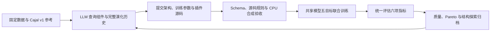

# nanoBrain

用于虚拟细胞架构、目标函数和训练策略的可复现实验项目。nanoBrain 将固定数据、可组合模型、统一评估和实验记录放在同一条研究流程中，作为 Brain World Model 的快速实验场。

[项目介绍网站](https://novaeve.github.io/nanobrain/) · [Cajal ReAct 变体](variants/cajal-react/README.md) · [数据发布](https://github.com/novaeve/nanobrain/releases/tag/cajal-react-data-20261106) · [原四任务教程](docs/tasks/)

## 本分支的研究路线

介绍网站以“提案、训练、复验、晋级”为主线。本分支沿用这套可追溯的研究流程，加入 **Cajal 联合模型上的 ReAct 架构与训练参数演化**。

| 项目 | 既有 nanoBrain 路线 | 本分支 Cajal ReAct 路线 |
|---|---|---|
| 数据 | 冻结 100k，60k / 20k / 20k | 1,015,388 个预训练细胞与三个独立研究评估集 |
| 输入 | 256-gene 表达面板 | 65,918 基因词表、原始 counts 与逐细胞测量面板 |
| 任务 | 注释、整合、发育、空间生态位 | 细胞类型、脑区、整合、基因插补、空间插补 |
| 模型 | 组件计算图与任务训练入口 | 一份共享模型、五目标联合训练、同一 checkpoint 评估 |
| 搜索 | 原 Graph V2 协议 | ReAct 工具调用、完整演化 DAG、受限源码扩展 |
| 候选预算 | 见既有协议配置 | 单 seed=0，每候选 10,000 步，30 代 × 10 候选 |
| 当前阶段 | 已有教程和历史评测 | 服务器独立训练实验已启动，源码同步于 2026-11-10 |

本变体的代码快照来自 `cajal-react-joint-20261106`，源提交为 `3891dc162cd9be5aa25876b948e02372ac86318e`。源码、配置、测试、组件库和数据发布记录位于独立目录 `variants/cajal-react/`。本分支基于 main 提交 `cdf4b197ed52b3c58bf357fbe701ffec0bdef455`。

## 演化实验流程



初始架构包括基因 token 编码、循环 MoE、N-BEATS 残差、层级分类头、NB 解码器和邻域模型。搜索可以组合 Cajal 与旧 nanoBrain 组件，也可以在候选源码约束内扩展模块、损失和优化器。组件目录登记 111 项，其中源快照记录了 52 个结构组件、67 个适用插槽接口的合成核验。

每个候选随机初始化一份共享模型，联合优化五项任务。父代传递架构、源码和超参数。断点恢复限定为同一候选、seed、协议和训练配置的自身 checkpoint。30,000 步学习率日程在 10,000 步固定停止。每代 10 次联合训练，30 代最多 300 次新训练。参考模型和对照方法使用已冻结的 Cajal 记录，详情见 [实验协议](variants/cajal-react/README_CAJAL_REACT.md)。

当前协议为 `CAJAL-V1-JOINT-REACT-SELF-CONTAINED-20261110`，候选训练采用 `random_init_self_contained`，教师 Gram 组件已关闭。调度允许 GPU 0–7，全局最多 16 个并行阶段，每卡最多 3 个 worker，每候选最多 2 条任务评估流水线。实际并发受显存与主存约束。服务器实时进度记录在部署目录的 `research-runs/cajal-react-self-contained-20261110/status.json`，配置中的 `status` 字段保留源码模板值。

## 五项任务与六个报告指标

| 任务 | 研究问题 | 报告指标 |
|---|---|---|
| 细胞类型注释 | 从表达预测细粒度细胞类型 | Fine macro-F1 ↑ |
| 脑区注释 | 从表达预测细粒度解剖脑区 | Fine macro-F1 ↑ |
| 批次整合 | 保留生物信号并降低批次影响 | Integration bio ↑、Integration batch ↑ |
| 基因插补 | 重建遮蔽的测量基因表达 | 每细胞 Pearson 相关的中位数 ↑ |
| 空间插补 | 利用可见邻居重建被遮蔽表达 | 每细胞 Pearson 相关的中位数 ↑ |

研究评估集与预训练细胞不重叠。它们会反复用于演化反馈，分数属于探索性研究结果。单 seed 的结果记录 `seed_count=1`、标准差为 null。完整口径见 [评估协议](variants/cajal-react/reference/evaluation_protocol.json)。

## 数据与下载

数据采用 main 相同的 GitHub Releases 存放方式。Cajal 数据使用独立发布标签 `cajal-react-data-20261106`，分卷附带 SHA-256 清单。

| 数据目录 | 细胞数 | 作用 |
|---|---:|---|
| `unified_1m` | 1,015,388 | 全量参与联合预训练 |
| `eval_10k` | 9,960 | 细胞类型、脑区、基因插补 |
| `eval_integration_10k` | 9,867 | 批次整合 |
| `eval_spatial` | 40,789 | 空间插补 |

```bash
git clone --branch research/cajal-react-joint-20261106 https://github.com/novaeve/nanobrain.git
cd nanobrain
python variants/cajal-react/scripts/download_data.py
```

下载器要求 Python 3.12+，默认解压到 `assets/cajal/`，校验每个分卷、合并归档、原始 manifest、行数和全部数据文件。完整解压体积约 16 GB，下载、合并和解压过程建议预留 35 GB 空间。已有分卷会通过校验后复用。

```bash
python variants/cajal-react/scripts/download_data.py --verify-only
```

来源、面板、邻居和抽样定义见 [数据说明](variants/cajal-react/data_build/UNIFIED_1M.md)。原 100k 发布仍可从 [v1.0.0-data](https://github.com/novaeve/nanobrain/releases/tag/v1.0.0-data) 获取。

## 从配置检查开始

Cajal 代码运行环境为 Linux、Python 3.11+、PyTorch 2.9+。正式训练使用 Linux NVIDIA GPU 环境及对应 CUDA 扩展。

```bash
cd variants/cajal-react
python -m pip install -e '.[dev]'
python -m brainwm_unified.cli show configs/experiments/cajal_v1.toml
python scripts/cajal_react.py
```

最后一条命令打印演化计划。正式启动需要显式 `--execute`、独立 Git 根目录、API 环境配置，以及协议要求的参考 checkpoint、整合评估缓存和可用组件依赖。服务器快照中的数据与参考路径有指纹约束，迁移前请按 [变体部署说明](variants/cajal-react/README.md) 准备这些输入。

原 nanoBrain 四任务教程、组件 API、自定义编码器和冻结排行榜位于 `docs/`、`src/`、`examples/` 和 `benchmarks/`。它们使用各自的数据与评估协议。

## 可复现记录

- 数据保留原 count、测量面板、标签层级、空间邻居和来源行身份。
- 每个候选保存完整配置、源码哈希、父系、种子、训练参数和全部任务指标。
- Schema 与源码验收之后，Linux bwrap 沙箱执行合成五目标梯度、更新和重载检查。
- 验收失败、训练失败、资源不足和指标缺失分别记录。完整 DAG 保留未入选分支。
- 六项指标共同参与质量、Pareto 与结构探索归档，晋级采用预先声明的工程阈值。

## 仓库结构

```text
variants/cajal-react/    Cajal 共享模型、ReAct 演化、组件库、配置与测试
assets/cajal/           下载后的约 1M 预训练数据及研究评估数据
src/                    既有 nanoBrain 与共享模型代码
docs/                   四任务教程、数据契约和组件接口
benchmarks/             原 100k 冻结评测记录
site/                   项目介绍网站源码
scripts/                原训练、评估和数据工具
```

## 参与实验

先确认数据和评估协议，再复现参考配置。组件变更保留来源、许可和接口检查，提交时说明训练预算、硬件、种子、各任务指标和失败记录。共享模型的改动需要同时核对全部五项任务。
