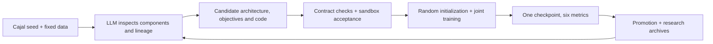

# nanoBrain

<p align="center">
  <strong>LLM-driven evolution of virtual-cell models: definition is open, evolution is frozen</strong>
</p>

<p align="center">
  <a href="#quick-start">Quick Start</a> ·
  <a href="#seed-model-cajal">Seed Model</a> ·
  <a href="#evolution-workflow">Evolution</a> ·
  <a href="#five-joint-tasks">Tasks</a> ·
  <a href="#commercial-value-and-applications">Applications</a> ·
  <a href="#contributing">Contributing</a>
</p>

**Language** English · [简体中文](README_zh-CN.md)


nanoBrain lets an LLM evolve virtual-cell models inside a controlled experiment. The LLM proposes architectures, objectives, and training strategies; the system validates, trains, evaluates, and selects them and keeps the evidence for every step. **Definition is open, evolution is frozen**: before a campaign starts, its data, tasks, metrics, opponents, and search space are yours to define; once it is frozen, all of that is locked, and any change is a new campaign. The [whitepaper](docs/whitepaper.md) is the user manual for this lifecycle. The earlier 100k-cell nanoBrain is preserved at tag [`nanobrain-v1-final`](https://github.com/novaeve/nanobrain/tree/nanobrain-v1-final).

The current seed model is **Cajal v1**, a shared virtual-cell model trained jointly on five tasks. Evolution starts from its architecture and training recipe. Every new candidate is initialized with random weights and evaluated through one shared checkpoint.

The nanoBrain website presents bounded experiments as a way to investigate model designs before larger Brain World Model training campaigns. nanoBrain develops that research workflow around Cajal, retaining the evidence behind each proposed change. [Project website](https://novaeve.github.io/nanobrain/)

> [!IMPORTANT]
> The current experiment uses 1,015,388 pretraining cells, a 65,918-gene vocabulary, and three disjoint research evaluation sets. Its fixed budget is 30 generations × 10 candidates, seed=0, and 10,000 training steps per candidate.

## Quick Start

### 1. Get the code and data

The data downloader requires Python 3.12+. Downloaded files are checked against the published SHA-256 manifest.

```bash
git clone https://github.com/novaeve/nanobrain.git
cd nanobrain
python scripts/download_data.py
```

The default data directory is `assets/cajal/`. The extracted datasets occupy about 16 GB. Allow approximately 35 GB for download, archive assembly, and extraction. [Data release](https://github.com/novaeve/nanobrain/releases/tag/cajal-react-data-20261106)

### 2. Install and freeze the campaign

The full workflow runs on Linux with NVIDIA GPUs and bubblewrap.

```bash
pip install -e '.[eval,scvi,dev]'
nanobrain --freeze      # lock campaigns/cajal-v1 (already frozen in this repository)
```

Prepare the matching PyTorch/CUDA extensions, component dependencies, fixed data paths, Cajal reference artifacts, integration evaluation cache, and controller API credentials using the deployment instructions. The campaign lock and the run contract verify these inputs. [Deployment instructions](docs/seed-cajal.md) · [Component dependencies](component_library/dependencies.json)

### 3. Inspect the plan and launch evolution

Run these commands from the prepared independent workspace and its configured training environment.

```bash
# Print the evolution plan
python -B scripts/cajal_react.py

# Explicitly start or resume LLM proposals and real training
python -B scripts/cajal_react.py --execute
```

Live progress is recorded in `research-runs/cajal-react-self-contained-20261110/status.json`. The configuration's `status` field retains its source-template value. The runtime file records the campaign's actual state.

## Seed model Cajal

Cajal v1 supplies the initial model architecture and joint-training recipe. It represents gene identity and expression together, builds a shared cell representation, and connects that representation to classification, expression reconstruction, and spatial prediction.

| Part | Role in the seed model |
|---|---|
| Gene-token encoder | Combines gene identity with expression-value embeddings |
| Attention and recurrent MoE blocks | Learn gene interactions through shared and routed experts |
| N-BEATS-style residual modules | Apply residual corrections within the encoder |
| Shared latent representation and hierarchical heads | Support integration, cell-type annotation, and brain-region annotation |
| Negative-binomial expression decoder | Models measured counts for expression reconstruction |
| Neighborhood model | Uses visible spatial neighbors for spatial imputation |

The seed recipe uses gradient-norm loss balancing and grouped Muon + AdamW. The frozen `cajal_v1@10000` checkpoint and its recorded scores provide the comparison reference. Candidate inheritance carries architecture, source code, and hyperparameters. Each new candidate trains from random initialization, and an interrupted candidate may resume its own identified checkpoint. [Seed recipe](configs/experiments/cajal_v1.toml) · [Reference record](reference/existing_cajal_v1_10k.json)

## Evolution workflow



1. **Propose.** The LLM inspects components, baselines, and the complete evolution DAG, then submits a candidate with a hypothesis, parent IDs, configuration, and declared source files.
2. **Validate.** Schema, parameter, and source-policy checks precede a Linux bwrap CPU sandbox. Synthetic acceptance checks cover tensor interfaces, five-task gradients, parameter updates, and checkpoint reload.
3. **Train and evaluate.** Accepted candidates train one shared model on all five objectives. The fixed-stop checkpoint produces all six report metrics through the common evaluation pipeline.
4. **Select and retain evidence.** Promotion checks improvements and regressions. Quality, Pareto, and structural-exploration archives guide subsequent proposals, while failed and unselected branches remain in the research history.

Promotion requires a target-metric improvement greater than 0.005 over both the parent and the fixed reference, a regression of at most 0.005 on every metric relative to the parent, and a better joint-frontier ordering. That ordering prioritizes the weakest relative margin against the baselines, then the average relative margin. [Selection implementation](nanobrain/infra/gate.py)

## Five joint tasks

| Task | Research question | Report metric |
|---|---|---|
| Cell-type annotation | Predict fine-grained cell identity from expression | Fine macro-F1 ↑ |
| Brain-region annotation | Predict fine-grained anatomical region | Fine macro-F1 ↑ |
| Batch integration | Preserve biology while reducing batch effects | Integration bio ↑ and Integration batch ↑ |
| Gene imputation | Reconstruct masked measured gene expression | Median per-cell Pearson correlation ↑ |
| Spatial imputation | Reconstruct hidden expression using visible neighbors | Median per-cell Pearson correlation ↑ |

All task scores come from the same candidate checkpoint. Frozen Cajal records provide the reference and 13 complete-method baselines. Evaluation scores are reused as exploratory feedback during evolution, with `seed_count=1` and null standard deviations. [Evaluation protocol](reference/evaluation_protocol.json) · [Baselines](reference/opponents.json)

## Data and scale

| Dataset | Cells | Role |
|---|---:|---|
| `unified_1m` | 1,015,388 | Joint pretraining on healthy human-brain cells |
| `eval_10k` | 9,960 | Cell-type, brain-region, and gene-imputation evaluation |
| `eval_integration_10k` | 9,867 | Integration evaluation |
| `eval_spatial` | 40,789 | Spatial-imputation evaluation |

The data retain raw counts, measured panels, label hierarchies, spatial neighbors, and source-row identity. Each research evaluation set is disjoint from pretraining. Dataset paths, masks, identities, and evaluation definitions are fixed by the protocol. [Data definition](data_build/UNIFIED_1M.md) · [Release manifest](reference/data-release.json)

To verify an existing download, run this command from the repository root.

```bash
python scripts/download_data.py --verify-only
```

## Evolution search and budget

| Search area | Candidate choices |
|---|---|
| Architecture | Value embeddings, token modules, attention/mixers, latent modules, classifiers, decoders, neighborhood models |
| Objectives | Five-task weights, loss balancing, FAMO, KL settings, supported regularizers |
| Optimization | Optimizer, learning rate, weight decay, gradient clipping, warmup, schedule |
| Sampling | Expression cells, spatial groups, nonzero-token limits, measured-zero sampling |
| Source extensions | Declared PyTorch modules, losses, and optimizers within the candidate interfaces |

The component catalog contains 111 entries. The source snapshot records 52 structural components verified across 67 applicable slot interfaces. Candidate models are limited to 200M parameters. Source files are limited to 32 KiB each and 128 KiB in total. [Component catalog](component_library/catalog.json) · [Candidate schema](schemas/cajal-candidate.schema.json)

| Protocol setting | Current source configuration |
|---|---|
| Protocol ID | `CAJAL-V1-JOINT-REACT-SELF-CONTAINED-20261110` |
| Proposal model | `gpt-6.1-sol`, `reasoning_effort=max` |
| Campaign | 30 generations × 10 candidates, at most 300 new joint trainings |
| Seed | Training and evaluation seed=0 |
| Training budget | 30,000-step learning-rate schedule, fixed stop at step 10,000 |
| Weight policy | `random_init_self_contained` |
| GPU scheduling | GPU 0–4, at most 16 concurrent stages and 3 workers per GPU |
| Acceptance and evaluation | Up to 4 CPU acceptance workers and 2 task-evaluation pipelines per candidate |

Memory reservations and available host memory further constrain concurrency. Same-generation parent pools are frozen, promotion decisions follow candidate order, and controller handoff adopts running stages. [Campaign configuration](configs/cajal_react.json) · [Detailed protocol](docs/react-protocol.md)

## Commercial value and applications

nanoBrain targets the R&D work between a model idea and a larger training commitment. Its potential commercial value comes from comparing designs under bounded budgets, making experiment evidence reusable, and preparing selected model artifacts for downstream research workflows. This application framing builds on the nanoBrain website's role for controlled experimentation ahead of larger Brain World Model campaigns. [Project website](https://novaeve.github.io/nanobrain/)

| Team | Supported workflow | Potential value |
|---|---|---|
| Model R&D teams | Compare architectures, objectives, and training strategies under a common contract | Prioritize engineering work and GPU experiments before larger campaigns |
| Bioinformatics and biotechnology research teams | Examine annotation, integration, and imputation trade-offs in one shared model | Select candidate representations for downstream analysis workflows |
| Internal AI platform teams | Queue bounded stages, recover identified jobs, and retain source hashes and receipts | Build traceable experiment services with explicit resource budgets |
| Data-platform and research-agent builders | Inspect exported candidate code, resolved configurations, and task metrics | Reuse model candidates and evaluation evidence in local research tools |

These are intended applications of the research workflow. Teams can assess their value using their own experiment costs and downstream validation requirements.

## Reproducibility and experiment artifacts

Every candidate records its hypothesis, source, parentage, seed, resolved configuration, training budget, and task metrics. Validation failures, resource limits, and incomplete metrics are recorded separately. The runtime checks code, configuration, data, references, and candidate identity when resuming.

Artifacts are stored under the independent workspace's `research-runs/cajal-react-self-contained-20261110/` directory.

| Artifact | Contents |
|---|---|
| `status.json` | Campaign phase, generation, active jobs, scheduler state |
| `run-contract.json` | Frozen code, configuration, input, and reference fingerprints |
| `lineage/` | Candidate bundles, source, parentage, acceptance, results |
| `jobs/` | Joint-training, prediction, and scoring checkpoints and receipts |
| `decisions/` | Candidate promotion decisions and supporting comparisons |
| `standard_metrics.csv` | Per-candidate, per-seed metrics and sampling parameters exported at completion |
| `frozen-champion.json` | Final candidate bundle, resolved training configuration, result, dependency list, and `improvement_found` |

## Repository layout

```text
campaigns/cajal-v1/   Campaign definition (campaign.toml, agent_brief.md) and its lock
nanobrain/infra/      Sealed infrastructure: contracts, validation, sandbox, scheduling, lineage, gate, freeze
nanobrain/agent/      ReAct agent and LLM client
brainwm_unified/      Cajal seed model, data loading, joint objectives, training
component_library/    Components, upstream sources, licenses, dependencies
configs/              Seed recipe and execution configuration
schemas/              Candidate configuration and source contracts
reference/            Evaluation protocol, baselines, release and provenance records
scripts/              Data download, prediction, scoring, retirement check
tests/                Contract, freeze, independent-training, concurrency, recovery checks
docs/                 Whitepaper, seed model, detailed protocol
assets/cajal/         Downloaded pretraining and research evaluation datasets
```

The Cajal ReAct source was imported from snapshot `3891dc162cd9be5aa25876b948e02372ac86318e` and its later commits through `e00fb1d`; all earlier branches are merged into `main`. [Source provenance](reference/source_snapshot.json)

## Contributing

1. Define the research hypothesis and affected model or training components.
2. Preserve the fixed data and evaluation contract, and declare candidate parameters and interfaces.
3. Record source provenance, licenses, hardware, seed, budget, six task metrics, and failures.
4. Submit the configuration, source, and experiment evidence together for review.

<details>
<summary>Protocol and implementation references</summary>

- [中文介绍](README_zh-CN.md)
- [Whitepaper / user manual](docs/whitepaper.md)
- [Deployment instructions](docs/seed-cajal.md)
- [Detailed evolution protocol](docs/react-protocol.md)
- [Candidate contracts](nanobrain/infra/contracts.py)
- [Selection and promotion](nanobrain/infra/gate.py)
- [Data release manifest](reference/data-release.json)
- [Source provenance](reference/source_snapshot.json)

</details>
