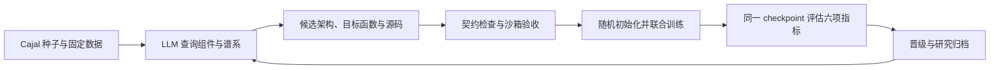

# nanoBrain Evolve

<p align="center">
  <strong>基于 nanoBrain 的演化研究版，从 Cajal 种子模型出发探索虚拟细胞架构</strong>
</p>

<p align="center">
  <a href="#快速开始">快速开始</a> ·
  <a href="#种子模型-cajal">种子模型</a> ·
  <a href="#演化工作流">演化流程</a> ·
  <a href="#五项联合任务">任务</a> ·
  <a href="#商业价值与应用方向">应用方向</a> ·
  <a href="#开发与贡献">开发与贡献</a>
</p>

**Language** [English](README.md) · 简体中文


nanoBrain Evolve 是在 nanoBrain 基础上改造而成的演化研究版。它延续 nanoBrain 的可组合模型、显式实验契约、统一评估和可复现记录，将这些能力连接为 LLM 驱动的自动研究流程。LLM 提出架构、目标函数与训练策略，实验系统负责验收、训练、评估和选择。[上游 nanoBrain](https://github.com/novaeve/nanobrain/tree/main)

当前采用 **Cajal v1 作为种子模型**。它是一份联合学习五项任务的虚拟细胞共享模型，演化从其架构和训练配方出发。每个新候选使用随机初始化的权重训练，并用同一个共享 checkpoint 接受全部评估。

nanoBrain 官网将受控实验定位为大规模 Brain World Model 训练之前的模型设计验证环节。nanoBrain Evolve 围绕 Cajal 扩展这条研究流程，保留每一次改动背后的提案与实验证据。[项目网站](https://novaeve.github.io/nanobrain/)

> [!IMPORTANT]
> 当前实验使用 1,015,388 个预训练细胞、65,918 基因词表及三个独立研究评估集。固定预算为 30 代 × 10 候选，seed=0，每候选训练 10,000 步。

## 快速开始

### 1. 获取源码与数据

数据下载器要求 Python 3.12+，下载文件按发布清单进行 SHA-256 校验。

```bash
git clone --branch research/nanobrain-evolve https://github.com/novaeve/nanobrain.git nanobrain-evolve
cd nanobrain-evolve
python variants/cajal-react/scripts/download_data.py
```

默认数据目录为 `assets/cajal/`。完整解压体积约 16 GB，下载、归档合并和解压过程建议预留约 35 GB 空间。[数据发布](https://github.com/novaeve/nanobrain/releases/tag/cajal-react-data-20261106)

### 2. 准备演化工作目录

完整演化流程在 Linux NVIDIA GPU 环境中的独立 Git 根目录下运行。在仓库根目录导出已发布的 Cajal 实现。

```bash
mkdir -p /work/nanobrain-evolve
git archive HEAD:variants/cajal-react | tar -x -C /work/nanobrain-evolve
cd /work/nanobrain-evolve
git init
git add .
git commit -m "Import nanoBrain Evolve source"
python -m pip install -e '.[dev]'
```

按部署说明准备匹配的 PyTorch/CUDA 扩展、组件依赖、Linux bwrap、固定数据路径、Cajal 参考工件、整合评估缓存及控制器 API 凭据。实验契约会核对这些输入。[部署说明](variants/cajal-react/README.md) · [组件依赖](variants/cajal-react/component_library/dependencies.json)

### 3. 查看计划与启动演化

以下命令在准备好的独立工作目录及其训练环境中执行。

```bash
# 打印演化计划
python -B scripts/cajal_react.py

# 显式启动或恢复 LLM 提案和真实训练
python -B scripts/cajal_react.py --execute
```

实时进度记录在 `research-runs/cajal-react-self-contained-20261110/status.json`。配置中的 `status` 字段保留源码模板值，运行时文件记录实验的实际状态。

## 种子模型 Cajal

Cajal v1 提供初始模型架构和联合训练配方。它共同表示基因身份与表达量，形成共享细胞表征，并将该表征连接到分类、表达重建和空间预测。

| 组成 | 在种子模型中的作用 |
|---|---|
| 基因 token 编码器 | 结合基因身份与表达数值嵌入 |
| Attention 与循环 MoE 模块 | 通过共享专家和路由专家学习基因间关系 |
| N-BEATS 风格残差模块 | 在编码器内部执行残差修正 |
| 共享 latent 与层级分类头 | 支持整合、细胞类型和脑区注释 |
| 负二项表达解码器 | 对测量到的 counts 建模，承担表达重建 |
| 邻域模型 | 利用可见空间邻居进行空间插补 |

种子配方采用梯度范数损失均衡和分组 Muon + AdamW。固定的 `cajal_v1@10000` checkpoint 与已有成绩作为比较参考。候选继承架构、源码和超参数，每个新候选从随机权重开始训练，中断后可恢复自身经过身份核验的 checkpoint。[种子配方](variants/cajal-react/configs/experiments/cajal_v1.toml) · [参考记录](variants/cajal-react/reference/existing_cajal_v1_10k.json)

## 演化工作流



1. **提案。** LLM 查询组件、基线与完整演化 DAG，提交包含假设、父代 ID、配置和声明源码的候选。
2. **验收。** Schema、参数和源码规则检查后，进入 Linux bwrap CPU 沙箱。合成验收覆盖张量接口、五任务梯度、参数更新与 checkpoint 重载。
3. **训练与评估。** 通过验收的候选联合训练一份共享模型，在固定停止点用同一 checkpoint 经统一评估流程输出六项报告指标。
4. **选择与保留证据。** 晋级判断同时检查改善与退化。质量、Pareto 和结构探索档案指导后续提案，失败与未入选分支进入研究历史。

晋级要求目标指标相对父代和固定参考均提升超过 0.005，任一指标相对父代的退化不超过 0.005，同时改善 joint-frontier 排序。排序优先比较相对基线最弱的一项，再比较平均相对增益。[选择实现](variants/cajal-react/cajal_research/selection.py)

## 五项联合任务

| 任务 | 研究问题 | 报告指标 |
|---|---|---|
| 细胞类型注释 | 从表达预测细粒度细胞身份 | Fine macro-F1 ↑ |
| 脑区注释 | 预测细粒度解剖脑区 | Fine macro-F1 ↑ |
| 批次整合 | 保留生物信息并降低批次差异 | Integration bio ↑、Integration batch ↑ |
| 基因插补 | 重建被遮蔽的测量基因表达 | 每细胞 Pearson 相关中位数 ↑ |
| 空间插补 | 利用可见邻居重建隐藏表达 | 每细胞 Pearson 相关中位数 ↑ |

所有任务成绩来自同一个候选 checkpoint。已有 Cajal 记录提供固定参考和 13 个整方法基线。评估成绩反复参与演化反馈，属于探索性研究结果，记录 `seed_count=1` 和 null 标准差。[评估协议](variants/cajal-react/reference/evaluation_protocol.json) · [参考基线](variants/cajal-react/reference/opponents.json)

## 数据与规模

| 数据集 | 细胞数 | 用途 |
|---|---:|---|
| `unified_1m` | 1,015,388 | 健康人脑细胞联合预训练 |
| `eval_10k` | 9,960 | 细胞类型、脑区与基因插补评估 |
| `eval_integration_10k` | 9,867 | 整合评估 |
| `eval_spatial` | 40,789 | 空间插补评估 |

数据保留原始 counts、测量面板、标签层级、空间邻居和来源行身份。各研究评估集与预训练细胞独立，数据路径、遮罩、行身份和评估定义由协议固定。[数据定义](variants/cajal-react/data_build/UNIFIED_1M.md) · [发布清单](variants/cajal-react/reference/data-release.json)

已有数据可在仓库根目录执行以下校验命令。

```bash
python variants/cajal-react/scripts/download_data.py --verify-only
```

## 演化搜索与预算

| 搜索方向 | 候选可选择的内容 |
|---|---|
| 架构 | 数值嵌入、token 模块、attention/mixer、latent、分类头、解码器、邻域模型 |
| 目标函数 | 五任务权重、损失均衡、FAMO、KL 设置和已开放的正则化目标 |
| 优化策略 | 优化器、学习率、weight decay、梯度裁剪、warmup、学习率日程 |
| 训练采样 | 表达细胞数、空间组数、非零 token 上限、测量零值采样 |
| 源码扩展 | 候选接口范围内声明的 PyTorch 模块、损失函数和优化器 |

组件目录登记 111 项，源快照记录了 52 个结构组件、67 个适用插槽接口的合成核验。候选模型上限为 200M 参数，源码每文件上限 32 KiB、合计上限 128 KiB。[组件目录](variants/cajal-react/component_library/catalog.json) · [候选 schema](variants/cajal-react/schemas/cajal-candidate.schema.json)

| 协议设置 | 当前源码配置 |
|---|---|
| 协议 ID | `CAJAL-V1-JOINT-REACT-SELF-CONTAINED-20261110` |
| 提案模型 | `gpt-6.1-sol`，`reasoning_effort=max` |
| 演化预算 | 30 代 × 10 候选，最多 300 次新联合训练 |
| 随机种子 | 训练与评估 seed=0 |
| 训练预算 | 30,000 步学习率日程，固定在 10,000 步停止 |
| 权重策略 | `random_init_self_contained` |
| GPU 调度 | GPU 0–7，最多 16 个并行阶段，每卡最多 3 个 worker |
| 验收与评估 | 最多 4 个 CPU 验收 worker，每候选最多 2 条任务评估流水线 |

显存预留和可用主存进一步限制实际并发。同代父代池冻结，晋级判断按候选序号应用，控制器交接接管已运行的阶段。[演化配置](variants/cajal-react/configs/cajal_react.json) · [详细协议](variants/cajal-react/README_CAJAL_REACT.md)

## 商业价值与应用方向

nanoBrain Evolve 面向从模型想法走向更大规模训练的研发环节。其潜在商业价值在于以受控预算比较设计、复用实验证据，并将选中的模型工件交给下游研究流程。这一应用定位延续了官网提出的先做受控实验、再进入更大规模 Brain World Model 训练的研究路径。[项目网站](https://novaeve.github.io/nanobrain/)

| 团队 | 可支持的工作流 | 潜在价值 |
|---|---|---|
| 模型研发团队 | 按统一契约比较架构、目标函数和训练策略 | 在更大规模训练前确定工程投入与 GPU 实验优先级 |
| 生物信息与生物技术研究团队 | 在共享模型上检查注释、整合和插补之间的权衡 | 为下游分析流程选择候选细胞表征 |
| 企业内部 AI 平台团队 | 调度有预算的阶段、恢复具备身份记录的作业、保留源码哈希与回执 | 构建可追溯、具有明确资源预算的实验服务 |
| 数据平台与科研智能体开发者 | 查看导出的候选源码、解析配置和任务指标 | 在本地研究工具中复用模型候选与评估证据 |

这些内容描述研究工作流的目标应用方向，团队可结合自身实验成本和下游验证要求评估价值。

## 可复现性与实验产物

每个候选记录假设、源码、父系、seed、解析配置、训练预算和任务指标。验收失败、资源限制和指标缺失分别保存。恢复时核对代码、配置、数据、参考工件与候选身份。

产物位于独立工作目录下的 `research-runs/cajal-react-self-contained-20261110/`。

| 产物 | 内容 |
|---|---|
| `status.json` | 实验阶段、代数、活动作业和调度状态 |
| `run-contract.json` | 代码、配置、输入和参考工件的冻结指纹 |
| `lineage/` | 候选 bundle、源码、父系、验收与结果 |
| `jobs/` | 联合训练、预测和评分的 checkpoint 与回执 |
| `decisions/` | 候选晋级判断及比较依据 |
| `standard_metrics.csv` | 完成后导出的逐候选、逐 seed 指标与采样参数 |
| `frozen-champion.json` | 最终候选 bundle、解析训练配置、结果、依赖清单和 `improvement_found` |

## 仓库结构

```text
variants/cajal-react/
  brainwm_unified/    Cajal 种子模型、数据加载、联合目标与训练
  cajal_research/     ReAct 工具、验收、调度、谱系、选择与恢复
  component_library/ 组件、上游源码、许可和依赖
  configs/           种子配方、搜索预算和实验配置
  schemas/           候选配置与源码契约
  reference/         评估协议、基线、数据发布与来源记录
  scripts/           数据下载、预测、评分和演化入口
  tests/             契约、独立训练、并发和恢复检查
assets/cajal/        下载后的预训练数据与研究评估集
```

研究实现发布在 `variants/cajal-react/`，已提交的源码快照为 `3891dc162cd9be5aa25876b948e02372ac86318e`，GitHub 分支为 `research/nanobrain-evolve`。[源码来源](variants/cajal-react/reference/source_snapshot.json)

## 开发与贡献

1. 明确研究假设及涉及的模型或训练组件。
2. 保留固定数据与评估契约，声明候选参数和接口。
3. 记录源码来源、许可、硬件、seed、预算、六项指标和失败情况。
4. 将配置、源码和实验证据一起提交评审。

<details>
<summary>协议与实现参考</summary>

- [English overview](README.md)
- [部署说明](variants/cajal-react/README.md)
- [详细演化协议](variants/cajal-react/README_CAJAL_REACT.md)
- [候选契约](variants/cajal-react/cajal_research/contracts.py)
- [选择与晋级](variants/cajal-react/cajal_research/selection.py)
- [数据发布清单](variants/cajal-react/reference/data-release.json)
- [源码来源](variants/cajal-react/reference/source_snapshot.json)

</details>
