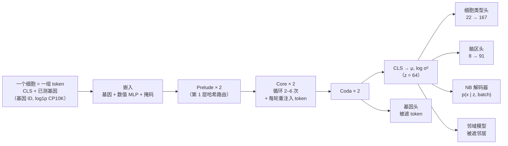

> **Cajal ReAct preparation — not started.** This independent checkout starts from the existing Cajal v1 architecture and jointly trains all five objectives. See [README_CAJAL_REACT.md](README_CAJAL_REACT.md) for the evolution protocol and preparation checks. The remaining document describes the original Cajal project.

# Cajal

<p align="center">
  <strong>一个编码器读懂脑细胞：细胞注释、脑区、整合、基因插补和空间，一起学。</strong>
</p>

<p align="center">
  <a href="#结果">结果</a> ·
  <a href="#架构">架构</a> ·
  <a href="#infra">Infra</a> ·
  <a href="#数据">数据</a> ·
  <a href="#上手">上手</a> ·
  <a href="#评估">评估</a> ·
  <a href="#目录">目录</a>
</p>

**语言：** [English](README.md) · 简体中文


-76B900?logo=nvidia&logoColor=white)


Cajal 是 **Brain World Model（BrainWM）** 当前版本的内部代号，也就是统一重构后的模型。一个 Transformer 编码器把每个细胞读成一组 `(基因, 表达量)` token，在同一张 **Cell × Gene 表** 上联合预训练五个目标：

| 目标 | 遮住或预测什么 | 对应的下游能力 |
|---|---|---|
| 基因插补 | 细胞里 15% 的已测基因 | 去噪、插补 |
| 整合 | 以批次为条件的负二项解码器（scVI 式）+ KL | 去批次的潜空间 |
| 细胞类型 | 层级头：谱系（22）→ 细胞类型（167） | 细胞注释 |
| 脑区 | 层级头：分区 → 区域（8）→ 结构（91） | 脑区注释 |
| 空间 | MERFISH 细胞 30% 的邻居，由生态位里其余细胞预测 | 空间插补 |

Cajal v0 把每个任务的 loss 除以它前 200 步的均值；Cajal v1 改成让每个 loss 在编码器上的梯度范数相同（`grad_equal`，见 [`balance.py`](brainwm_unified/balance.py)）。发育、衰老、扰动、疾病等下游任务之后作为后训练接入。

> [!NOTE]
> Cajal 是在一台 8×H20 服务器上持续开发的研究代码。`scripts/` 里的路径和数据默认值指向这台服务器（`/data/brainwm/...`），各目录内容见[数据](#数据)。

## 结果

在从未参与预训练的细胞上零样本评估（四个评估集，每类任务一个，见[数据](#数据)），不做任何微调。所有对照方法都用同一份预训练数据（unified_1m）和同样的 2,000 个高变基因训练；scVI、scANVI 在 GPU 上运行，用 scvi-tools 推荐的图谱整合设置。

| 方法 | 细胞类型 F1 | 脑区 F1 | 整合 bio | 整合 batch | 基因插补 r | 空间插补 r |
|---|---:|---:|---:|---:|---:|---:|
| **Cajal v0**（3 万步） | **0.811** | **0.767** | 0.611 | 0.263 | **0.789** | 0.271 |
| scANVI（细胞类型 / 脑区标签） | 0.703 | 0.497 | 0.625 | 0.454 | – | – |
| scVI | – | – | 0.609 | 0.449 | – | – |
| scVI（直接在评估集上拟合） | – | – | 0.623 | **0.504** | – | – |
| XGBoost（GPU） | 0.743 | 0.682 | – | – | – | – |
| 逻辑回归（cuML） | 0.740 | 0.634 | – | – | – | – |
| 未整合 PCA | – | – | 0.581 | 0.267 | – | – |
| 同 panel kNN / 基因均值 | – | – | – | – | 0.700 / 0.531 | – |
| 邻居平均（对数 / CP10K 空间） | – | – | – | – | – | **0.368** / 0.276 |

F1 为细粒度 macro-F1；整合用 [scib-metrics](https://github.com/YosefLab/scib-metrics) 评分（batch = 整合批次，label = 细胞类型）；插补 r 是 log1p CP10K 上每个细胞 Pearson 相关的中位数。所有指标、粗细两级和训练轨迹在 `runs/eval/<任务>/table_latest/` 和 `runs/eval/five_tasks.csv`。

- **领先：** 细胞类型和脑区注释（超过 XGBoost、逻辑回归和 scANVI），基因插补（超过 kNN）。
- **落后：** 去批次，scVI 和 scANVI 去掉的批次信号更多（0.45 对 0.26）；空间插补，在对数空间对邻居取平均仍然更好。
- **整合为什么落后：** 每个任务 loss 除以初始值后，整合只拿到编码器 2–3% 的梯度。改成每个 loss 梯度范数相同（`grad_equal`）后，1 万步时去批次从 0.228 提到 0.358，其他任务不变，这就是 **Cajal v1** 的设置（3 万步，训练中）。背后保留和放弃的实验及结论，用 `cajal catalog experiments` 查看。

## 架构



每个 block 先在细胞自己的 token 内做注意力，再过 DeepSeek 式混合专家，并带 N-BEATS 的 backcast/forecast 残差。

| 组件 | 设置 |
|---|---|
| 宽度 / 头 | d = 256，4 头 × 64 维 |
| 注意力 | FlashAttention-3 变长，每个细胞一条序列（无 padding、不跨细胞） |
| MoE | 32 个路由专家（top-4）+ 1 个共享专家，SwiGLU 隐层 256；sqrt-softplus 路由（V4）；无辅助 loss 的偏置均衡（V3）；第一层按基因 ID 路由（V4 哈希路由） |
| 深度 | 2 prelude + 2 core 循环 2–6 次（评估时 4 次）+ 2 coda = 12 次 block 调用 |
| 潜空间 | z = 64，评估用 μ |
| 优化器 | 隐藏层矩阵用 Muon（批量 Newton–Schulz），其余 AdamW；lr 1e-3，余弦衰减，1k 步 warm-up |
| 每步 | 128 个解离细胞 + 16 个空间组（中心 + 16 个邻居），约 31 万 token |

## Infra

在同一张 H20、同一份真实 batch 上测量。每项改动都先用 GPU 测试确认和原实现一致，再保留。

| 改动 | 效果 |
|---|---|
| FlashAttention-3 变长，4 头 × 64 维 | 注意力 kernel 比 FlexAttention 8 × 32 快 2.3 倍 |
| 分组 Muon（同形状矩阵一次批量 Newton–Schulz） | 优化器每步 254 → 约 10 ms |
| 3D 专家权重、gate/up 合并 GEMM、分发和合并只用 gather | 无原子操作；显存 −2.8 GB |
| 按 block `torch.compile`（约 20 个变体全部编译） | 1.88 → 1.11 秒/步 |
| 只重算循环层的 MoE 分支 | 0.97 → 0.88 秒/步 |
| 专家计数不再同步主机 | GPU 忙碌 91% → 96% |
| **合计（真实训练循环）** | **2.90 → 0.85 秒/步，每秒 138 → 约 470 个细胞；MFU 约 16% → 约 50%** |

推理参照大模型 prefill 的做法（`brainwm_unified/infer.py`）：不加掩码、确定性 token、按 token 预算切 batch、DataLoader 预取、`inference_mode`、只算需要的模块。1 万个评估细胞约 18 秒，GPU 98% 时间在算，注意力约达峰值的 87%。试过 FP8 注意力（快 4%，但 1.7% 的预测改变），没有采用。

剖析工具：`scripts/bench/profile_step.py`（分阶段计时和 Chrome trace）、`scripts/bench/flops.py`（真实 batch 上的理论 FLOPs 和 MFU）、`scripts/bench/trace_gaps.py`（GPU 空转间隙及其 CPU 原因）、`scripts/bench/bench_attention.py`、`scripts/bench/bench_moe.py`、`scripts/bench/bench_infer.py`。

## 数据

| 数据集 | 细胞数 | 内容 |
|---|---:|---|
| `unified_1m` | 1,015,388 | 预训练。来自 V4 train + validation 分片的健康人脑：314,566 个空间细胞（MERFISH，按 500 µm 方块整块抽取）+ 700,822 个仅表达细胞，按"细胞类型 × 脑区"和数据集设上限。65,918 个基因上的原始 count；每个细胞的测量面板区分"没测"和"测了是 0"。 |
| `eval_10k` | 9,960 | 注释和基因插补。unified_1m 里**没有**、且标签在 unified_1m 中出现过的 V4 train/validation 细胞；用 IPF 同时均衡脑区和细胞类型，数据集在每层内均摊、单个数据集不超过 5%。 |
| `eval_integration_10k` | 9,867 | 整合。55 个至少由 3 个批次共有的细胞类型，每个（细胞类型, 批次）配额相同，批次和生物学不混淆（49 个批次）。 |
| `eval_spatial` | 40,789 | 空间插补。46 块完整的 500 µm MERFISH 切块（24 个切片，2 个经验证的空间数据集），不含任何预训练或其他评估集的细胞；每个细胞都有 16 个邻居。 |

评估集与 unified_1m 以及彼此之间都不重叠；密封的 V4 test 部分从未读取。

两者都由 [`data_build/`](data_build/) 里的脚本构建（细节见 [`data_build/UNIFIED_1M.md`](data_build/UNIFIED_1M.md)）。

## 上手

Linux x86_64、CUDA 12.8、Hopper GPU、[uv](https://docs.astral.sh/uv/)。

```bash
uv venv -p 3.11 && uv pip install -e . --torch-backend cu128
bash scripts/build_fa3.sh          # 把 FlashAttention-3（Hopper）编进 venv，约 3 分钟；需要 gcc >= 11（toolchain/）
source env.sh

# 每个实验是 configs/experiments/ 下的一个 TOML；catalog 列出每个实验的状态和结论
cajal catalog experiments
# 联合预训练，3 万步，单卡（H20 上约 7.5 小时）
cajal run configs/experiments/cajal_v1.toml --gpus 0

# 单任务对照：只有 TASK 的 loss 权重非零
cajal run configs/experiments/single_task.toml --gpus 0,1

# 在一张 GPU 上跑全部测试（lint + 53 个测试，约 1 分钟）
bash scripts/gate.sh 0
```

## 评估

五个任务、四个评估集，`runs/eval/` 下每个任务一个文件夹（预测、每个 checkpoint 一个评分目录、`table_latest/summary.csv` 和 `trajectory.csv`）：

| 任务 | 评估集 | 模型输出 | 对照 |
|---|---|---|---|
| 细胞类型、脑区 | eval_10k | 标签头，粗细两级 | 2,000 个高变基因上的逻辑回归（cuML）、XGBoost（GPU） |
| 整合 | eval_integration_10k | 潜变量 μ，scib-metrics bio / batch | 未整合 PCA；scVI、scANVI（scvi-tools，GPU），同样的高变基因 |
| 基因插补 | eval_10k | 训练时的 15% 基因遮盖（固定种子），由基因头补全 | 基因均值、同 panel kNN |
| 空间插补 | eval_spatial | 每个细胞被隐藏，由它的 16 个邻居重建 | 邻居平均（对数和 CP10K 空间） |

评估命令见英文 README 的 [Evaluation](README.md#evaluation)（每个任务一个 `eval_watch.sh`，对照方法用 `eval_zero_shot.py` 和 `fit_scvi.py`，`merge_tables.py` 汇成一张表）。

## 目录

```
brainwm_unified/
  model.py           编码器、MoE、各个头、解码器、邻域模型、注意力后端
  objectives.py      五个 loss
  balance.py         loss 配平（initial / grad_equal / famo）和带预算的对偶权重
  regularizers.py    额外的整合目标（注册表）
  masking.py         掩码即任务：行 / 组掩码、混合、计划（configs/masks/）
  data.py            Cell × Gene 批次：token、掩码、panel、空间组
  train.py           联合预训练循环、梯度探针
  infer.py           只前向的推理：嵌入、基因插补、空间插补
  impute_metrics.py  模型和对照共用的插补指标（NumPy）
  experiment.py      TOML 实验：extends、覆盖、扫描、状态 / 结论
  cli.py             cajal catalog | show | run | predict | eval
configs/             base、数据、模型、掩码计划、实验（每个都写明状态和结论）
scripts/             评估和启动流程；scripts/bench/ 是剖析和微基准
data_build/          构建 unified_1m 和各评估集的脚本
tests/               CPU 和 GPU 测试：每个 kernel、每项 infra 改动和每个指标
```

## 致谢

Cajal 建立在开源基础设施之上：[FlashAttention-3](https://github.com/Dao-AILab/flash-attention)、[DeepGEMM](https://github.com/deepseek-ai/DeepGEMM)、[DeepEP](https://github.com/deepseek-ai/DeepEP)、[torchtitan](https://github.com/pytorch/torchtitan) 的按区域编译做法、[Muon](https://github.com/KellerJordan/Muon)、[scib-metrics](https://github.com/YosefLab/scib-metrics)、[RAPIDS cuML](https://github.com/rapidsai/cuml) 和 [XGBoost](https://github.com/dmlc/xgboost)。思路来自 scVI（整合）、scBrain（层级头）、DeepSeek-V3/V4（MoE 路由）和 N-BEATS（残差堆叠）。详见 [THIRD_PARTY.txt](THIRD_PARTY.txt)。

以圣地亚哥·拉蒙-卡哈尔（Santiago Ramón y Cajal）命名，他最先把大脑画成由一个个细胞组成的世界。
