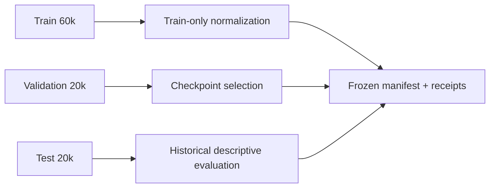

# nanoBrain

<p align="center">
  <strong>一个可读、可改、可复现的小型虚拟细胞实验入口</strong>
</p>

<p align="center">
  <a href="#快速开始">快速开始</a> ·
  <a href="#四项任务">四项任务</a> ·
  <a href="#数据与规模">数据与规模</a> ·
  <a href="#leaderboard">Leaderboard</a> ·
  <a href="#自定义模型">自定义模型</a> ·
  <a href="#开发与贡献">开发与贡献</a>
</p>


nanoBrain 是面向科研、教学和原型验证的小型虚拟细胞建模项目。它借鉴 nanoGPT 和自动化研究框架的思路，把数据加载、模型定义、训练、验证和结果比较压缩成一条容易读懂、容易修改、容易复现的实验路径。

nanoBrain 是 Brain World Model 的快速实验入口，不是 Brain World Model 的缩小部署版本。新结构、新损失函数、新采样策略和新任务可以先在 nanoBrain 的小型数据集上验证，再将有效方案扩展到更大规模的细胞数据和模型训练中。

> [!IMPORTANT]
> 当前仓库随附的基准是经过冻结和校验的 100,000 细胞 metadata-v2 数据：60,000 train / 20,000 validation / 20,000 test。10M 级数据属于内部规模化接入路线，不随当前 Git 仓库提交，也不会在没有授权的数据地址时自动下载。

> [!WARNING]
> 固定测试集的标签和历史结果已经开放。新的模型选择只能使用 train/validation；Leaderboard 中的 test 分数用于描述性比较，不是新的盲测结果。

## 快速开始

### 1. 准备环境

推荐 Linux x86_64、Python 3.12 和 [uv](https://docs.astral.sh/uv/)。在服务器或工作站上：

```
git clone <your-internal-repository-url> nanobrain
cd nanobrain

# 一键安装 CPU 版 PyTorch、开发依赖并准备数据
cp .env.example .env
# 如果数据尚未落盘，在 .env 中填写 NANOBRAIN_DATA_URL；
# 如果数据包有归档校验值，再填写 NANOBRAIN_DATA_SHA256。
bash scripts/bootstrap.sh
```

如果公司数据包已经放在 assets/nanobrain_v3_100k_metadata_v2/，准备步骤只会校验清单和文件哈希。数据包不会提交到 Git。

也可以分步执行：

```
uv sync --extra cpu --extra dev
uv run nanobrain-data prepare
```

### 2. 运行一个最小实验

```
uv run python scripts/train_nanobrain.py \
  --data assets/nanobrain_v3_100k_metadata_v2 \
  --task annotation \
  --steps 20 \
  --batch-size 16 \
  --device cpu \
  --precision fp32 \
  --output results/annotation-smoke
```

20 步只用于检查数据加载、模型构建、反向传播、验证和回执写入，不代表正式 benchmark 的训练预算。训练完成后，输出目录会包含 checkpoint 和 JSON receipt。

### 3. 切换任务

将 --task 改为以下任一值：

```text
integration
annotation
development
spatial_niche
```

发育任务还可以指定采样和验证规模：

```
uv run python scripts/train_nanobrain.py \
  --data assets/nanobrain_v3_100k_metadata_v2 \
  --task development \
  --steps 20 \
  --batch-size 16 \
  --development-cells 64 \
  --validation-development-groups 8 \
  --device cpu \
  --precision fp32 \
  --output results/development-smoke
```

### 4. 运行测试与重建 Leaderboard

```
uv run pytest
uv run python scripts/build_leaderboard.py
```

CI 使用同一套测试、lint 和 leaderboard 生成流程，见 [.github/workflows/ci.yml](.github/workflows/ci.yml)。

## 项目工作流


每个任务独立训练模型和优化器。正常训练只读取 train 和 validation，不打开 test。每次运行都会记录任务、数据清单、随机种子、训练步数、验证结果、checkpoint 和稳定性信息，方便在内部服务器上复现实验和比较方案。

## 四项任务

| 任务 | 解决的问题 | 主要指标 | 教程 |
|---|---|---|---|
| **Integration** | 保持表达生物学信息，同时减少 batch signal | Integration composite、biology conservation、batch removal | [整合教程](docs/tasks/integration.md) |
| **Annotation** | 根据表达预测训练集中出现过的细胞类型标签 | Macro F1、accuracy | [注释教程](docs/tasks/annotation.md) |
| **Development** | 根据源群体和发育条件预测目标群体 | Population MSE、gene Spearman、MMD | [发育教程](docs/tasks/development.md) |
| **Spatial niche** | 结合表达和已验证空间邻域预测 anatomy-derived niche | ARI、NMI、空间指标 | [Niche 教程](docs/tasks/spatial-niche.md) |

这些任务共享数据契约、模型组件注册表、训练器和评估器，但使用独立的目标函数、模型头和优化器。

## 数据与规模

### 当前可复现基准

| 属性 | 当前发布值 |
|---|---|
| 数据集 | nanobrain_v3_100k_metadata_v2 |
| 总细胞数 | 100,000 |
| 划分 | 60,000 train / 20,000 validation / 20,000 test |
| Split ID | BRAINWM-HUMAN-GLOBAL-6-2-2-V3 |
| 表达面板 | 256 genes |
| 归一化 | 只使用 train 拟合 |
| 元数据 | metadata-v2，包含 row identity 修复 |
| 空间邻域 | 仅使用独立验证过的 section |

数据准备命令会检查 split ID、精确行数、metadata 版本、train-only normalization 和 manifest 中声明的每个文件哈希。它不会随机重划分数据，也不会在训练循环中打开 H5AD。



详见 [数据契约](docs/data.md) 和 [数据目录说明](assets/README.md)。

### 数据规模路线

| 级别 | 目标用途 | 状态 |
|---|---|---|
| Teaching | 课程、教程和 CPU 冒烟实验 | 当前 quick start 可运行 |
| Benchmark | 固定 100k 数据和四项任务 | 当前发布基准 |
| Scale-up | 10M 级数据、更多 shard 和服务器训练 | 内部数据接入路线 |

10M 数据需要经过批准的数据主机、访问权限、存储和服务器配置。仓库中的数据准备接口已经保留了 URL、归档校验和清单校验入口；规模化数据的具体路径、授权和发布许可会在内部数据契约中补充。

## Leaderboard

当前 leaderboard 由冻结的统一评估表生成：

- [Leaderboard](benchmarks/nanobrain_v3_100k/LEADERBOARD.md)
- [机器可读指标](benchmarks/nanobrain_v3_100k/overall_metrics.csv)
- [benchmark 状态与协议](docs/benchmark_status.md)

nanoBrain 参考结果来自固定模型、三个随机种子和每个 seed 2,000 个 optimizer steps：

| 任务 | 指标 | Mean | SD | 趋势 |
|---|---|---:|---:|---|
| Annotation | Accuracy | 0.2644 | 0.0101 | 越高越好 |
| Annotation | Macro F1 | 0.0136 | 0.0012 | 越高越好 |
| Integration | Integration composite | 0.3764 | 0.0152 | 越高越好 |
| Spatial niche | ARI | 0.0601 | 0.0282 | 越高越好 |
| Spatial niche | NMI | 0.1027 | 0.0138 | 越高越好 |
| Development | Population MSE | 0.2315 | 0.0076 | 越低越好 |
| Development | Gene Spearman | 0.5859 | 0.0340 | 越高越好 |

不同方法的训练预算、数据覆盖和评估数量可能不同。比较结果时请同时查看方法协议、seed 数量和评估行数。

重新生成摘要：

```
uv run python scripts/build_leaderboard.py \
  --input benchmarks/nanobrain_v3_100k/frozen_test_metrics.csv
```

## 自定义模型

nanoBrain 用组件注册表保持模型可替换。默认路径包括：

- MLP expression encoder
- Differential linear attention
- Bounded neighbor-mean spatial fusion
- N-BEATS-style residual correction
- Sinkhorn population matching
- Flow Matching Transformer
- Classification、regression 和 completion task heads

编码器可以接收 [batch, genes]，返回 [batch, hidden] 或 [batch, tokens, hidden]。最小插件示例见 [examples/custom_encoder.py](examples/custom_encoder.py)：

```
uv run python scripts/train_nanobrain.py \
  --data assets/nanobrain_v3_100k_metadata_v2 \
  --plugin examples.custom_encoder \
  --genome-json examples/custom_genome.json \
  --task annotation \
  --steps 20 \
  --batch-size 16 \
  --device cpu \
  --precision fp32 \
  --output results/custom-annotation
```

完整说明见 [自定义模型教程](docs/custom-model.md)。训练回执会记录插件模块名和源文件哈希。

## 服务器与 GPU

当前 quick start 面向 Linux CPU，也适合在小型云主机或工作站上验证方案。GPU 训练需要根据服务器 CUDA runtime，从 [PyTorch 安装选择器](https://pytorch.org/get-started/locally/)安装匹配的 PyTorch wheel，然后将设备改为：

```
--device cuda
```

nanoBrain 当前提供实验 CLI、训练回执和统一评估流程，不把实验 CLI 伪装成在线推理服务。内部部署、远程数据主机和 10M shard 训练应在对应服务器上配置独立的数据路径和权限。

## 复现与公平比较

每个实验至少固定以下信息：

- 数据 manifest 和 split ID
- task、seed、训练步数和 batch size
- validation split 与评估设置
- 模型 genome 和插件源哈希
- checkpoint policy 与稳定性阈值

新的架构或损失函数应先在 train/validation 上迭代，再决定是否进入更大规模训练。不要根据已经展示的 test leaderboard 调参。

## 项目结构

```text
src/nanobrain/       nanoBrain 模型、数据契约、任务目标和训练器
src/brainwm*/        共用的模型、数据和 benchmark 组件
scripts/             环境、数据、训练、评估和 leaderboard 命令
docs/tasks/          四项任务教程
benchmarks/          冻结 100k leaderboard 和源指标
configs/             公共模型配置
examples/            自定义编码器和 genome 示例
tests/               合约、数据、训练、评估和 leaderboard 测试
assets/              数据目录说明；实际数据不进 Git
```

## 面向使用者的能力

| 使用者 | 可以用 nanoBrain 做什么 |
|---|---|
| 专业研究人员 | 快速比较结构、损失函数、采样策略和任务头 |
| 生信分析人员与学生 | 从一套可读代码学习单细胞数据表示、训练和评估 |
| 数据库与智能体开发者 | 将细胞表征、注释和检索能力接入本地分析流程 |
| 内部平台团队 | 在固定预算下自动运行实验、保存回执并汇总 leaderboard |

## 路线图

- [x] 固定 100k metadata-v2 数据契约
- [x] 整合、注释、发育和 spatial niche 四项任务
- [x] CPU quick start、训练回执和统一 leaderboard
- [x] 可替换组件注册表和自定义编码器示例
- [ ] 10M 级数据 shard 与权限化下载配置
- [ ] Teaching / benchmark / scale-up 多级数据配置
- [ ] 更完整的 GPU、云端和服务器运行模板
- [ ] 自动化实验搜索、预算控制和结果保留策略
- [ ] 面向生信数据库与科研智能体的本地推理接口

## 内部开源与贡献

这是一个面向公司内部开源的研究基础项目。建议贡献遵循以下流程：

1. 先用现有 100k 数据和四项任务复现基线。
2. 为新的组件、任务或数据处理逻辑补充最小测试。
3. 保留数据 manifest、seed、训练预算和验证回执。
4. 更新对应教程、benchmark 协议或 Leaderboard 生成逻辑。
5. 提交 Pull Request，并说明硬件、运行时间和可复现命令。

贡献前请阅读 [组件指南](docs/components.md)、[数据契约](docs/data.md) 和 [第三方依赖说明](docs/third_party.md)。

<details>
<summary>常见问题</summary>

### 没有公司数据 URL 能启动吗？

如果已把批准的数据包放在默认目录，可以直接运行训练。否则需要在 .env 中设置 NANOBRAIN_DATA_URL，并可选设置 NANOBRAIN_DATA_SHA256。

### 20 步能得到正式结果吗？

不能。20 步只验证流程；固定 benchmark 的 nanoBrain 参考训练为每个 seed 2,000 步。

### 可以直接把 test 用于调参吗？

不可以。当前 test 标签已经开放，新的模型搜索应只使用 train/validation。

### 是否包含完整 10M 数据？

当前仓库不包含 10M 数据。10M 规模需要内部数据主机、权限、存储和单独的数据发布契约。

### 是否提供在线 API？

当前仓库提供训练和评估 CLI，不包含生产在线服务。在线推理接口属于后续部署路线。

</details>

## 项目定位

nanoBrain 以低门槛、可理解、可复现为优先级，产品目标是让一条核心实验路径保持在不到 500 行的可读范围内，并在数分钟级 smoke run 中完成一次可验证实验；完整仓库仍包含数据契约、任务实现、评估器和测试。先让研究人员在数万到数十万细胞规模、单卡 GPU、工作站或云端实例上验证想法，再把有效方案交给更大规模的 Brain World Model 训练。它适合科研、教学和原型验证，不是临床决策系统，也不对固定数据集之外的人群作性能承诺。

## 引用、许可证与发布

当前版本的引用、内部开源许可证、数据发布许可和公司数据主机信息应按内部发布流程补充。第三方复用说明见 [docs/third_party.md](docs/third_party.md)。

<details>
<summary>相关文档</summary>

- [英文 README](README.md)
- [组件指南](docs/components.md)
- [数据契约](docs/data.md)
- [Benchmark 状态](docs/benchmark_status.md)
- [自定义模型](docs/custom-model.md)
- [四项任务教程](docs/tasks/)
- [第三方依赖](docs/third_party.md)

</details>


