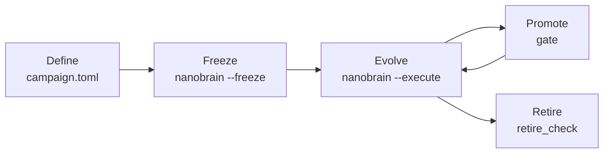

# nanoBrain Whitepaper · User Manual

**Language** English · [简体中文](whitepaper_zh-CN.md)

> **In one line: definition is open, evolution is frozen.**
> Before evolution starts, you define the data, tasks, metrics, opponents and search space; nanoBrain provides
> the infrastructure. Once a campaign is frozen and evolving, all of that is locked, and any change is a
> different campaign.

nanoBrain lets an LLM evolve virtual-cell models inside a controlled experiment. The LLM proposes candidate
architectures, objectives and training recipes; the system validates them, trains them in isolation, evaluates
them with one fixed pipeline, decides promotion, and keeps the evidence for every step. The current seed model
is **Cajal v1** (one shared encoder trained jointly on five objectives) and the current campaign is `cajal-v1`.

---

## 1. Why separate "open" from "frozen"

In a self-evolving system the weak point is usually the judge, not the model:

| Risk | Consequence | What nanoBrain does |
|---|---|---|
| Data or evaluation sets change mid-run | Scores stop being comparable | Data manifest hashes are locked and checked on every start and resume |
| Metrics or thresholds change mid-run | Rules chosen after seeing results | Metrics, ranges and the gate live in the definition and cannot change once frozen |
| Candidate code reads labels, batches or test data | Leakage | The sandbox exposes only declared tensors and committed source, with no network or credentials |
| Historical weights or pretrained teachers pass as "evolution" | Gains are not reproducible | `random_init_self_contained`: every candidate trains from random initialization |
| Only good results are reported | Selection bias | Failed and unselected branches stay in the lineage |

Hard-coding all of this would limit nanoBrain to one experiment. So the boundary is drawn by **lifecycle**,
not by code: everything is definable before freezing, and everything is verifiable after.

## 2. Lifecycle



| Stage | Who | Open | Sealed | Command / file |
|---|---|---|---|---|
| **Define** | People | Data, tasks, metrics, opponents, budget, gate, search space, agent brief | Infrastructure (validators, sandbox, scheduler, records) | `campaigns/<id>/campaign.toml`, `agent_brief.md` |
| **Freeze** | People | — | Definition, seed model, task and judge files, data manifests | `nanobrain --freeze` → `campaign.lock.json` |
| **Evolve** | LLM + system | Candidates: configuration, components and tensor plugin code inside the search space | Everything frozen; all code for the duration of a run (`run-contract.json`) | `nanobrain --execute` |
| **Promote** | System | — | Gate rules | `nanobrain/infra/gate.py` |
| **Retire** | People + tool | — | Deletion only with proof nothing is lost | `scripts/retire_check.py` |

## 3. Repository map

```text
campaigns/<id>/          open → frozen   everything that defines one campaign
  campaign.toml                           data, objectives, metrics, budget, resources, gate, search space, freeze list
  agent_brief.md                          the LLM's system brief
  campaign.lock.json                      written at freeze time and committed; read-only afterwards
nanobrain/
  infra/                 sealed          contracts and candidate validation, code policy, sandbox, worker,
                                          GPU scheduling, handoff, lineage store, workflow, gate, freeze
  agent/                                 ReAct loop and LLM client
  cli.py                                 the `nanobrain` command
brainwm_unified/         seed model      Cajal v1 source (locked by the campaign)
component_library/       maintained      composable parts: Cajal, split scVI/scANVI parts, upstream methods, legacy nanoBrain parts
configs/                                 seed recipe (experiments/cajal_v1.toml) and execution config (cajal_react.json)
reference/                               reference scores, opponents, evaluation protocol, data fingerprints
scripts/                                 data download, prediction, scoring, retirement check
tests/                                   every guarantee has a test
```

**Little code where it is open, a lot of code where it is sealed**: a campaign's choices fit in one TOML and
one Markdown file; `nanobrain/infra` and `tests/` make sure those choices are honoured.

## 4. Define: write a campaign

Using `campaigns/cajal-v1/campaign.toml` as the example:

| Section | Content | Cajal v1 |
|---|---|---|
| `[campaign]` | id, seed description, reference recipe, reference result, weight policy, agent brief file | `CAJAL-V1-JOINT-REACT-SELF-CONTAINED-20261110`; `random_init_self_contained` |
| `[budget]` | LR schedule length, fixed stop, seeds, checkpoint selection, automatic scaling | 30,000-step schedule stopped at 10,000; seed 0; `fixed_stop`; no scaling |
| `[resources]` | GPU whitelist and reason | GPUs 0–4 |
| `[objectives]` | joint training objectives; must equal the seed model's losses | gene, integration, cell_type, anatomy, spatial |
| `[[metrics]]` | each metric's name, task group and valid range | six metrics, below |
| `[gate]` | regression tolerance for promotion | 0.005 |
| `[search]` | searchable model fields and values, train/data/optimizer ranges, plugin kinds | see `campaign.toml` |
| `[freeze]` | extra task and judge files locked at freeze time, seed model directory | 4 evaluation scripts, 13 reference records, `brainwm_unified` |

| Task group | Metrics | Range |
|---|---|---|
| annotation | Cell type fine macro-F1, Region fine macro-F1 | [0, 1] |
| integration | Integration bio, Integration batch | [0, 1] |
| genes | Gene imputation Pearson (cell median) | [-1, 1] |
| spatial | Spatial imputation Pearson (cell median) | [-1, 1] |

**Data** is referenced by `data` in the execution config `configs/cajal_react.json`; every data root needs a
`manifest.json`, whose path and hash are locked at freeze time. Current data:

| Dataset | Cells | Role |
|---|---:|---|
| `unified_1m` | 1,015,388 | Joint pretraining |
| `eval_10k` | 9,960 | Cell-type, region and gene-imputation evaluation |
| `eval_integration_10k` | 9,867 | Integration evaluation |
| `eval_spatial` | 40,789 | Spatial-imputation evaluation |

**Execution config vs. definition**: `configs/cajal_react.json` holds execution choices (concurrency, LLM model,
credential file, output). Its seeds, steps, reference recipe, weight policy and GPUs must match the definition,
or `load_config` refuses it.

**A new campaign**: copy a campaign directory, edit `campaign.toml` and `agent_brief.md`, give it a new id and
set `NANOBRAIN_CAMPAIGN=campaigns/<new>`. Objectives must equal the seed model's losses and metric names must be
unique with valid ranges; this is checked on load.

> Guarantee: `tests/test_campaign_definition.py` asserts that the Cajal definition equals, value by value, the
> constants that used to be hard-coded, that the objectives match the seed model, and that the brief is the
> former prompt.

## 5. Freeze: nothing changes from here on

```bash
nanobrain --freeze          # or: python -m nanobrain.cli --freeze
git add campaigns/<id>/campaign.lock.json && git commit
```

| Locked | Detail |
|---|---|
| Definition | `campaign.toml`, `agent_brief.md` |
| Reference recipe | `configs/experiments/cajal_v1.toml` |
| Seed model | every tracked file under `brainwm_unified/` |
| Tasks and judges | evaluation scripts, reference scores, opponents, evaluation protocol and cache fingerprints listed in `[freeze].files` |
| Data | absolute path and `manifest.json` SHA-256 of every data root |

From then on:

- **Every start and resume verifies the lock.** A missing lock or any changed file or data root is refused, and
  the changed paths are listed.
- **The same id cannot be re-frozen with different contents.** A change means a new campaign.
- The lock digest is recorded in each run's `run-contract.json`.

**Not in the campaign lock**: infrastructure code (`nanobrain/infra` and the rest). Each run's
`run-contract.json` pins the hash of every tracked file, so code cannot change during a run, but infrastructure
can improve between campaigns. Run outputs (checkpoints, logs, predictions) stay out of git in the run directory.

> Guarantee: `tests/test_freeze.py` covers an unfrozen campaign, a changed definition, changed data, a moved data
> root and re-freezing under the same id, and verifies the Cajal lock wherever its data is present.

## 6. Evolve: the LLM proposes, the system judges

```bash
nanobrain                   # print the plan only; no LLM call, no training
nanobrain --execute         # explicitly start or resume real evolution
```

**A candidate** is one JSON document (`examples/research/candidate.json`): parent ids, target metrics, a
hypothesis, complete overrides relative to the seed (`model` / `train` / `data`), component choices and plugin
source. Every value must lie inside the defined search space.

**The LLM's tools** (`nanobrain/agent/react.py`): inspect the contract, list components, read baselines, read
candidate artifacts, read lineage, stage a candidate, run a CPU synthetic check, submit. There is no shell,
network or dataset access.

**Plugin interfaces** (the open code surface; `torch` tensor code only):

| Kind | Signature |
|---|---|
| `token_transform` | `build(hidden_dim, **declared) -> nn.Module`; maps one cell's token states `[1, L, D]` to the same shape |
| `gene_loss` | `compute(prediction[M], target[M], **declared)`; differentiable, nonnegative scalar |
| `cell_type_loss` / `anatomy_loss` | `compute(logits[B, C], target[B], **declared)`; applied at every hierarchy level |
| `optimizer` | `build(parameters, lr, weight_decay, **declared) -> Optimizer` |

Limits: plugin names `custom_*`; numeric parameters need bounds; ≤ 32 KiB per file and ≤ 128 KiB in total;
models ≤ 200M parameters.

**Sandbox** (`nanobrain/infra/sandbox.py`, bubblewrap): separate network, PID and IPC namespaces, no credentials;
only committed source roots are mounted; CPU synthetic checks mount neither data nor GPUs; a GPU job gets exactly
one whitelisted GPU.

**Training**: every candidate starts from random initialization, trains all five objectives jointly, stops at
the defined step, and one checkpoint produces all six metrics.

### Evolution operators

| Phase | How parameters change | Status |
|---|---|---|
| Training | architecture, components, losses, optimizer, recipe → backpropagation | implemented |
| Inference | parameter optimization without gradients, e.g. steering: extract representation directions from contrastive samples and edit a few weights | reserved, not implemented |

Inference-phase evolution reads an already-trained checkpoint, which differs from the current
`random_init_self_contained` weight policy, so it will come as a campaign with its own weight policy, defined and
frozen like any other.

## 7. Promote: what counts as an improvement

Rules live in `nanobrain/infra/gate.py`; parameters come from the definition:

1. No metric drops below the parent by more than `regression_floor` (0.005).
2. The target metric is the parent's weakest metric relative to the best opponent; if the candidate did not
   declare it, the weakest of the candidate's declared targets. On it the candidate must beat both the parent
   and the fixed reference by more than 0.005.
3. The joint-frontier ordering improves: first the weakest margin over baselines, then the mean margin.

**Honest evidence**: the current campaign has one seed, so results are labelled `single_seed_exploratory`, with
no standard deviation and no significance claim. Evaluation sets are disjoint from pretraining but are reused as
evolution feedback, so results are exploratory rather than a fresh blind test; the sealed test set is not
accessible. Failed and unpromoted candidates are kept and can serve as parents.

## 8. Records and reproducibility

Run directory (for Cajal v1 `research-runs/cajal-react-self-contained-20261110/` by default, or `--output`):

| File | Content |
|---|---|
| `run-contract.json` | code, configuration, data, campaign lock, reference and opponent fingerprints; resume requires an exact match |
| `status.json` | phase, generation, active jobs, scheduler state |
| `lineage/` | every candidate's bundle, source, parents, acceptance and result (the full DAG) |
| `jobs/` | training, prediction and scoring checkpoints and receipts |
| `decisions/` | promotion decisions and their comparisons |
| `standard_metrics.csv` | per-candidate metrics exported at the end |
| `frozen-champion.json` | final candidate, resolved training configuration, result and `improvement_found` |

## 9. Retire: old things must be provably deletable

An old branch, worktree or directory may be deleted only once its contents are proven to be preserved:

```bash
python scripts/retire_check.py --repo <unified repo> --source <old location> --target main \
    --file-list <file list from the NAS index> [--archive-ref archive/<name>]
```

| Verdict | Meaning |
|---|---|
| `RETIRABLE` | every branch and tag is an ancestor of `main` (or every file matches the archive commit byte for byte) and nothing is uncommitted; safe to delete |
| `RETIRABLE_AFTER_DATA_MOVE` | code is fully preserved; what remains is experiment data outside git, to be moved or decided by a person |
| `BLOCKED` | something cannot be found in `main`; do not delete |

On the shared NAS the file list always comes from the path index (`nasfind`); the tool never walks directories.

## 10. What nanoBrain does not guarantee

- That evolution finds a better model; "no improvement" is a valid, recorded outcome.
- Statistical conclusions from single-seed results.
- That the frozen rules are good. Freezing guarantees the rules do not change within a campaign; whether they are
  sensible is decided by people at definition time.
- Security against arbitrary Python: static checks of plugin code plus an OS sandbox isolate candidates, they do
  not prove safety.

## Appendix: commands

| Purpose | Command |
|---|---|
| Install | `pip install -e '.[eval,scvi,dev]'` |
| Download and verify data | `python scripts/download_data.py` (`--verify-only` to check) |
| Show the plan | `nanobrain` |
| Freeze a campaign | `nanobrain --freeze` |
| Start or resume evolution | `nanobrain --execute` |
| Switch campaign | `NANOBRAIN_CAMPAIGN=campaigns/<id> nanobrain ...` |
| Tests | `bash scripts/gate.sh <GPU>` |
| Retirement check | `python scripts/retire_check.py ...` |
