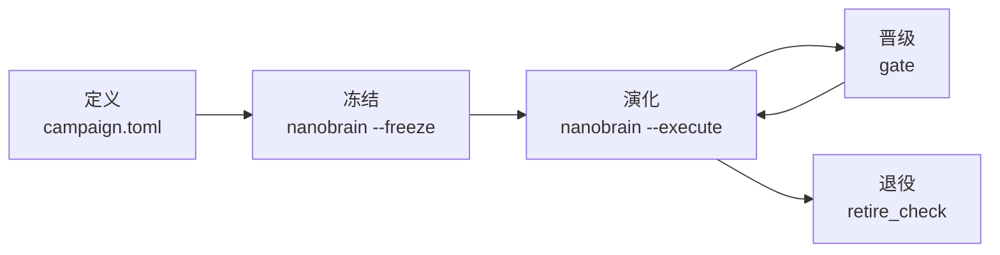

# nanoBrain 白皮书 · 使用手册

**Language** [English](whitepaper.md) · 简体中文

> **一句话：定义是开放的，演化是冻结的。**
> 演化开始之前，数据、任务、指标、对手和搜索空间都由你来定义，nanoBrain 提供基础设施；
> 一旦冻结并开始演化，这些就锁死，任何改动都意味着另一个 campaign。

nanoBrain 是一个让 LLM 在受控实验中演化虚拟细胞模型的系统：LLM 提出候选架构、目标函数和训练配方，
系统负责校验、隔离训练、统一评估和晋级判定，并保留每一步的证据。`cajal-v3-seed` 分支默认使用
**Cajal v3**（共享编码器，五个目标联合训练）及 `cajal-v3` campaign。原分支保留 Cajal v1 实验。

---

## 1. 为什么要把“开放”和“冻结”分开

自演化系统最容易出问题的地方不是模型，而是裁判：

| 风险 | 后果 | nanoBrain 的处理 |
|---|---|---|
| 演化中途换数据、换评估集 | 分数不可比，改进可能只是数据变了 | 数据清单哈希写进锁文件，启动和续跑都核对 |
| 演化中途改指标或门槛 | 等于事后挑规则 | 指标、范围、门槛都在定义里，冻结后不可改 |
| 候选代码读到标签、批次或测试集 | 信息泄漏 | 沙箱只暴露声明过的张量和已提交的源码，无网络、无凭据 |
| 用历史权重或预训练教师冒充“进化” | 改进不可复现 | `random_init_self_contained`：每个候选从随机初始化训练 |
| 只报好结果 | 选择性偏差 | 失败、未晋级的分支全部留在谱系里 |

但如果把这些都写死在代码里，nanoBrain 就只能做一种实验。所以边界按**生命周期**划分，而不是按代码划分：
冻结之前一切可定义，冻结之后一切可验证。

## 2. 生命周期



| 阶段 | 谁来做 | 开放 | 封死 | 命令 / 文件 |
|---|---|---|---|---|
| **定义** | 人 | 数据、任务、指标、对手、预算、门槛、搜索空间、给 LLM 的说明 | 基础设施（校验器、沙箱、调度、记账） | `campaigns/<id>/campaign.toml`、`agent_brief.md` |
| **冻结** | 人 | — | 定义、种子模型、任务与裁判文件、数据清单 | `nanobrain --freeze` → `campaign.lock.json` |
| **演化** | LLM + 系统 | 候选：搜索空间内的配置、组件和张量插件代码 | 冻结的一切；运行期间的全部代码（`run-contract.json`） | `nanobrain --execute` |
| **晋级** | 系统 | — | 门槛规则 | `nanobrain/infra/gate.py` |
| **退役** | 人 + 工具 | — | “必须能证明没有丢东西”才能删 | `scripts/retire_check.py` |

## 3. 仓库地图

```text
campaigns/<id>/          开放 → 冻结   一个 campaign 的全部定义
  campaign.toml                         数据、目标、指标、预算、资源、门槛、搜索空间、冻结清单
  agent_brief.md                        给 LLM 的系统说明
  campaign.lock.json                    冻结后生成并提交；之后只读
nanobrain/
  infra/                 封死          基础设施：合约与候选校验、代码白名单、沙箱、worker、
                                        GPU 调度、交接、谱系存储、工作流、晋级门槛、冻结
  agent/                               ReAct 循环与 LLM 客户端
  cli.py                               命令入口 `nanobrain`
brainwm_unified/         种子模型      Cajal v3 源码（冻结进 campaign 锁）
component_library/       维护          可组合组件：Cajal、scVI/scANVI 拆分组件、上游方法、旧版 nanoBrain 组件
configs/                               种子配方（experiments/cajal_v3.toml）与执行配置（cajal_react_v3.json）
reference/                             参考成绩、对手、评估协议、数据指纹（被冻结清单引用）
scripts/                               数据下载、预测、评分、退役检查
tests/                                 每一条保证都有对应测试
```

**开放的地方代码很少，封死的地方代码很多**：一个 campaign 的全部选择写在一个 TOML 和一个 Markdown 里；
保证这些选择不被违反的是 `nanobrain/infra` 和 `tests/`。

## 4. 定义：写一个 campaign

默认使用 `campaigns/cajal-v3/campaign.toml` 的定义。

| 节 | 内容 | Cajal v3 的取值 |
|---|---|---|
| `[campaign]` | id、种子说明、参考配方、参考成绩、权重策略、LLM 说明文件 | `CAJAL-V3-JOINT-REACT-UNIFIED-1M`、`random_init_self_contained` |
| `[budget]` | 学习率调度长度、固定停止步、种子、checkpoint 选择方式、是否自动扩展 | 30,000 步调度，第 10,000 步停止；seed 0；`fixed_stop`；不扩展 |
| `[resources]` | 可用 GPU 白名单及理由 | GPU 0–4 |
| `[objectives]` | 联合训练的目标名，必须与种子模型的损失一致 | gene、integration、cell_type、anatomy、spatial |
| `[[metrics]]` | 每个评估指标的名字、所属任务组、合法范围；可选 `direction`（默认 `max`，误差类用 `min`）和 `tolerance`（指标自身单位，默认 `regression_floor`） | 6 个指标，见下表 |
| `[gate]` | 晋级门槛的回退容差 | 0.005 |
| `[search]` | 可搜索的模型字段与取值、训练/数据/优化器范围、插件种类 | 见 `campaign.toml` |
| `[freeze]` | 冻结时额外锁定的任务与裁判文件、种子模型目录，以及可在 `[freeze.data_files]` 中指定的数据集标签文件 | 评估脚本、参考记录、继承配方和掩码、`brainwm_unified` |

v3 实验沿用六项评估指标。

| 任务组 | 指标 | 范围 |
|---|---|---|
| annotation | Cell type fine macro-F1、Region fine macro-F1 | [0, 1] |
| integration | Integration bio、Integration batch | [0, 1] |
| genes | Gene imputation Pearson (cell median) | [-1, 1] |
| spatial | Spatial imputation Pearson (cell median) | [-1, 1] |

`configs/cajal_react_v3.json` 的 `data` 指向 Cajal v1 实验使用的同一批训练和评估数据。每个数据根需包含 `manifest.json`，冻结时记录它的路径和哈希。

| 数据集 | 细胞数 | 用途 |
|---|---:|---|
| `unified_1m` | 1,015,388 | 联合预训练 |
| `eval_10k` | 9,960 | 细胞类型、脑区注释与基因补全评估 |
| `eval_integration_10k` | 9,867 | 整合评估 |
| `eval_spatial` | 40,789 | 空间补全评估 |

`configs/cajal_react_v3.json` 设置并发、LLM 模型和凭据文件等执行参数。seed、步数、参考配方、权重策略和 GPU 必须与 campaign 定义一致。

**新建一个 campaign**：复制一个已有目录，改 `campaign.toml` 和 `agent_brief.md`，给一个新 id，
设置 `NANOBRAIN_CAMPAIGN=campaigns/<新目录>`。`[objectives]` 必须与种子模型的损失一致，
指标名必须唯一、范围合法，这些在加载时就检查。

`tests/test_campaign_definition.py` 校验 campaign 配置，并保留对历史 Cajal v1 契约的检查。

### 示例：年龄任务

种子模型带一个可选的年龄任务：输入一个细胞的表达，输出**受精后天数的区间**（始终为正；出生 = 266 天）。
默认关闭（`model.age_head = ""`）；关闭时，现有的配方、参考和锁都不变。

| 部分 | 位置 | 作用 |
|---|---|---|
| 标签 | `data_build/build_age.py` | 在数据集旁写 `age_lower_dpf.npy` / `age_upper_dpf.npy`：每个细胞的年龄是天数区间 `[lo, hi)`。报告的年龄按其分辨率覆盖（"73y" 是一年，"14pcw" 是一周）；范围或 "> 90 y" 就用给出的区间；只有阶段的标签用该生命阶段的区间 |
| 模型 | `brainwm_unified/age.py`，`model.age_head = "logistic"`（或 `"gauss"`） | 共享隐变量上的头输出对数天数上的位置和尺度。标签是区间删失的：损失是标签区间概率的负对数。报告区间取中间 90%（`model.age_alpha = 0.1`） |
| 留出 | `data.age_holdout = 0.15`，`data.age_holdout_unit = "dataset"` | 训练时隐藏 15% 数据集的年龄标签（存为 `age_holdout.npz`）。评估集的供体都在预训练里，头可以学到“数据集 → 平均年龄”；只有留出的数据集才检验从表达读年龄 |
| 评估 | `scripts/eval_age.py` | 在留出组和已见组上、按年龄段（产前、0–18 岁、18–65 岁、> 65 岁）报告：覆盖率、宽度和中位误差（天），对数天数上的 interval score；`--out` 为 worker 写 `summary.csv` |
| 基线 | `scripts/eval_age.py`、`scripts/fit_age_baseline.py` | 数据集均值先验（只读数据集；模型只到这个水平说明学到的是批次而不是生物学），以及表达上的 ridge 加 split conformal 区间 |
| Campaign | `campaigns/cajal-v1-age/` | 草稿：年龄作为第六个目标，两个年龄指标（`direction = "min"`），年龄标签随数据一起锁定。未冻结，未运行 |

现状：一万细胞的试验（2026-11-14）是负结果。在留出数据集上没有一个变体胜过数据集均值先验；在已见数据集上头读的是数据集身份；整合的 batch 指标下降。年龄应当作为需要对照两条基线和批次指标来检验的任务，而不是已经解决的输出。

运行试验配方并评分：

```bash
.venv/bin/python -m brainwm_unified.train --config configs/experiments/age/logistic.toml
.venv/bin/python scripts/predict_eval.py --checkpoint runs/age/logistic/latest.pt --data /data/brainwm/eval_10k --out runs/eval/age/logistic.npz --task embed
.venv/bin/python scripts/eval_age.py runs/eval/age/logistic.npz --holdout runs/age/logistic/age_holdout.npz --train-root /data/brainwm/unified_1m
```

## 5. 冻结：从这一刻起不能再改

```bash
nanobrain --freeze          # 或 python -m nanobrain.cli --freeze
git add campaigns/<id>/campaign.lock.json && git commit
```

锁文件记录：

| 锁定对象 | 说明 |
|---|---|
| 定义 | `campaign.toml`、`agent_brief.md` |
| 参考配方 | `configs/experiments/cajal_v3.toml` |
| 种子模型 | `brainwm_unified/` 下所有已跟踪文件 |
| 任务与裁判 | `[freeze].files` 中声明的评估脚本、参考成绩、对手、评估协议、缓存指纹 |
| 数据 | 每个数据根的绝对路径与 `manifest.json` 的 SHA-256 |

之后：

- **每次启动和续跑都核对锁文件**，没有锁、任何文件或数据不一致都拒绝运行，并列出改动的文件。
- **同一个 id 不能重新冻结成不同内容**；要改，就定义一个新的 campaign。
- 锁文件的摘要写进每次运行的 `run-contract.json`。

**不在 campaign 锁里的东西**：基础设施代码（`nanobrain/infra` 等）。它由每次运行的
`run-contract.json` 锁定全部已跟踪文件的哈希，运行中途不能变，但可以在两个 campaign 之间改进。
实验产物（checkpoint、日志、预测）不进 git，由运行目录保存。

> 保证：`tests/test_freeze.py` 覆盖未冻结、改定义、改数据、数据换位置、同 id 重冻五种情况，
> 并在数据可用的机器上核对 Cajal 锁文件。

## 6. 演化：LLM 提案，系统裁判

```bash
nanobrain                   # 只打印计划，不调用 LLM、不训练
nanobrain --execute         # 显式开始或续跑真实演化
```

**一个候选是什么**：一份 JSON（`examples/research/candidate.json`），包含父代 id、目标指标、假设、
相对种子的完整覆盖（`model` / `train` / `data`）、组件选择和插件源码。所有值必须在定义的搜索空间内。

**LLM 能用的工具**（`nanobrain/agent/react.py`）：查看合约、浏览组件、查看基线、读取候选产物、
查看谱系、写入候选、在 CPU 上做合成校验、提交。没有 shell、网络或数据集访问。

**插件接口**（开放的代码面，只允许 `torch` 张量代码）：

| 种类 | 签名 |
|---|---|
| `token_transform` | `build(hidden_dim, **declared) -> nn.Module`，输入一个细胞的 token 状态 `[1, L, D]`，输出同形状 |
| `gene_loss` | `compute(prediction[M], target[M], **declared)`，可微、非负标量 |
| `cell_type_loss` / `anatomy_loss` | `compute(logits[B, C], target[B], **declared)`，作用于层级的每一级 |
| `optimizer` | `build(parameters, lr, weight_decay, **declared) -> Optimizer` |

限制：插件名 `custom_*`；数值参数必须声明上下界；单文件 ≤ 32 KiB、总计 ≤ 128 KiB；模型 ≤ 200M 参数。

**沙箱**（`nanobrain/infra/sandbox.py`，bubblewrap）：独立的网络、PID、IPC 命名空间，无凭据；
只挂载已提交的源码根目录；CPU 合成校验不挂载数据和 GPU；GPU 只给白名单内的一张。

**训练**：每个候选从随机初始化开始，五个目标联合训练，按定义的预算在固定步停止，一个 checkpoint 产出全部六个指标。

### 演化算子

| 阶段 | 优化方式 | 状态 |
|---|---|---|
| 训练阶段 | 架构、组件、损失、优化器、训练配方 → 反向传播 | 已实现 |
| 推理阶段 | 不做梯度更新的参数优化，例如 steering：用对照样本提取表征方向、定向修改少量权重 | 预留，未实现 |

推理阶段的演化需要读取已训练的 checkpoint，与当前 campaign 的 `random_init_self_contained` 权重策略不同，
因此它会以另一种权重策略、另一个 campaign 的形式出现，并同样先定义、再冻结。

## 7. 晋级：什么算改进

规则在 `nanobrain/infra/gate.py`，门槛参数来自定义：

1. 任何指标相对父代变差都不超过它的 `tolerance`（默认 `regression_floor`，0.005）；“变差”按指标的 `direction` 判断。
2. 目标指标取父代**相对最强对手最弱**的那一项；如果它不在候选声明的目标里，就取候选声明的目标中相对最弱的一项。候选在这项指标上相对父代和固定参考都必须提升超过 0.005。
3. 联合前沿的排序变好：先比相对基线最弱的一项，再比平均相对增益。

**证据等级要说实话**：当前 campaign 只有一个种子，结果标记为 `single_seed_exploratory`，不报告标准差、
不声称显著性。评估集与预训练细胞不重叠，但会反复用作演化反馈，所以是探索性结果，不是新的盲测；
密封的测试集不可访问。失败和未晋级的候选同样保存，可作为后续父代。

## 8. 记录与复现

Cajal v3 实验默认写入 `research-runs/cajal-v3-react/`。可通过 `--output` 指定运行目录。

| 文件 | 内容 |
|---|---|
| `run-contract.json` | 本次运行的代码、配置、数据、campaign 锁、参考和对手指纹；续跑必须完全一致 |
| `status.json` | 阶段、代数、活跃任务、调度状态 |
| `lineage/` | 每个候选的 bundle、源码、父代、校验和结果（完整 DAG） |
| `jobs/` | 训练、预测、评分的 checkpoint 和回执 |
| `decisions/` | 晋级判定及其比较 |
| `standard_metrics.csv` | 结束时导出的逐候选指标 |
| `frozen-champion.json` | 最终候选、解析后的训练配置、结果和 `improvement_found` |

## 9. 退役：旧东西必须能被证明可以删除

任何旧分支、旧 worktree、旧目录，只有在证明其内容已完整保存后才能删除：

```bash
python scripts/retire_check.py --repo <统一仓库> --source <旧位置> --target main \
    --file-list <来自 NAS 索引的文件清单> [--archive-ref archive/<名字>]
```

| 结论 | 含义 |
|---|---|
| `RETIRABLE` | 所有分支和标签都是 `main` 的祖先（或所有文件在存档提交中逐字节一致），没有未提交改动，可以删除 |
| `RETIRABLE_AFTER_DATA_MOVE` | 代码已完整保存；剩下的是不进 git 的实验数据，需要先迁移或由人决定 |
| `BLOCKED` | 有内容无法在 `main` 中找到，不能删除 |

在共享 NAS 上，文件清单一律来自路径索引（`nasfind`），工具不遍历目录。

## 10. nanoBrain 不保证什么

- 不保证演化一定找到更好的模型；“没有改进”是合法且会被记录的结果。
- 单种子结果不是统计结论。
- 冻结保证的是“同一个 campaign 内规则不变”，不保证规则本身合理；规则是否合理在定义阶段由人负责。
- 插件代码的静态检查加 OS 沙箱是隔离手段，不是对任意 Python 的安全证明。

## 附录：命令速查

| 目的 | 命令 |
|---|---|
| 安装 | `pip install -e '.[eval,scvi,dev]'` |
| 下载并校验数据 | `python scripts/download_data.py`（`--verify-only` 只校验） |
| 查看计划 | `nanobrain` |
| 冻结 campaign | `nanobrain --freeze` |
| 开始或续跑演化 | `nanobrain --execute` |
| 切换 campaign | `NANOBRAIN_CAMPAIGN=campaigns/<id> nanobrain ...` |
| 测试 | `bash scripts/gate.sh <GPU>` |
| 退役检查 | `python scripts/retire_check.py ...` |
